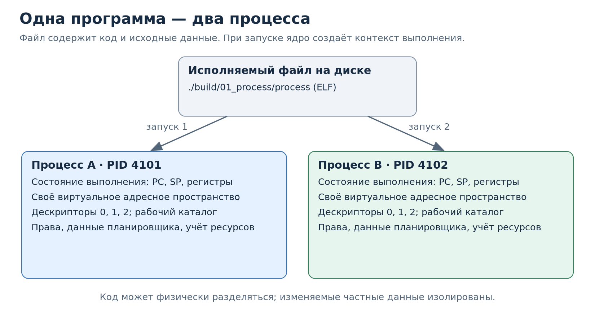
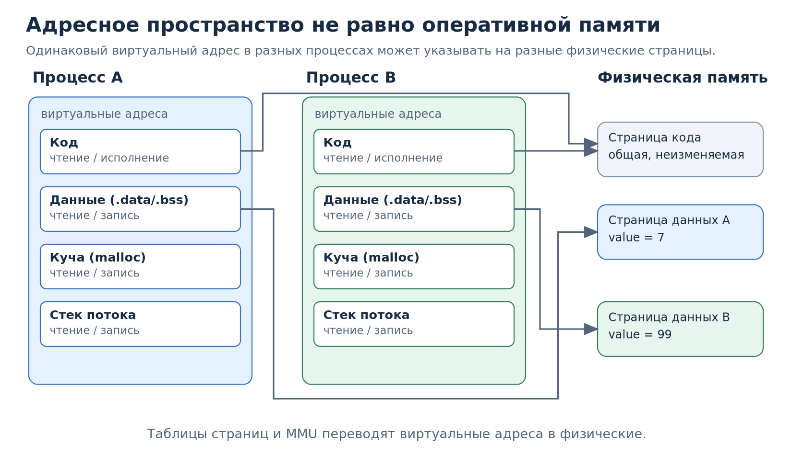
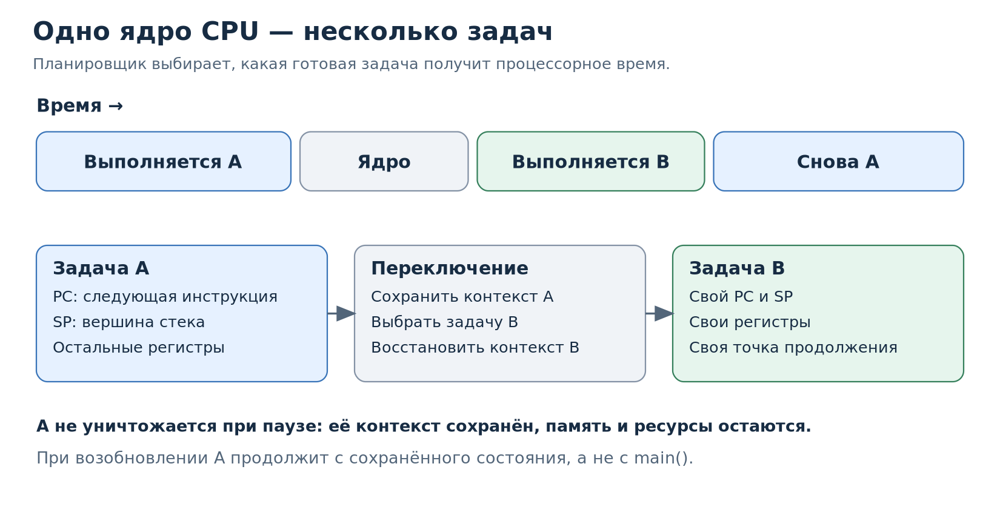
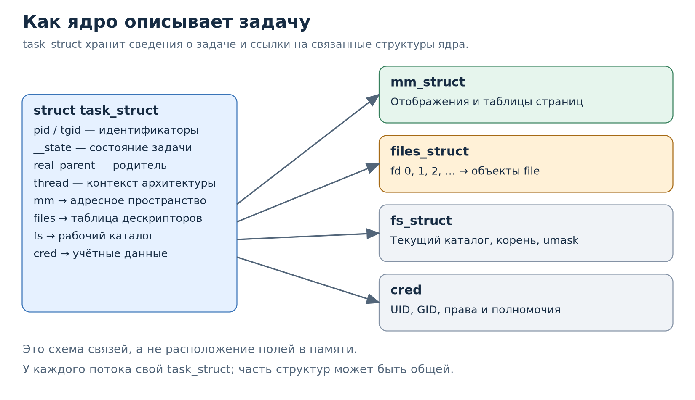
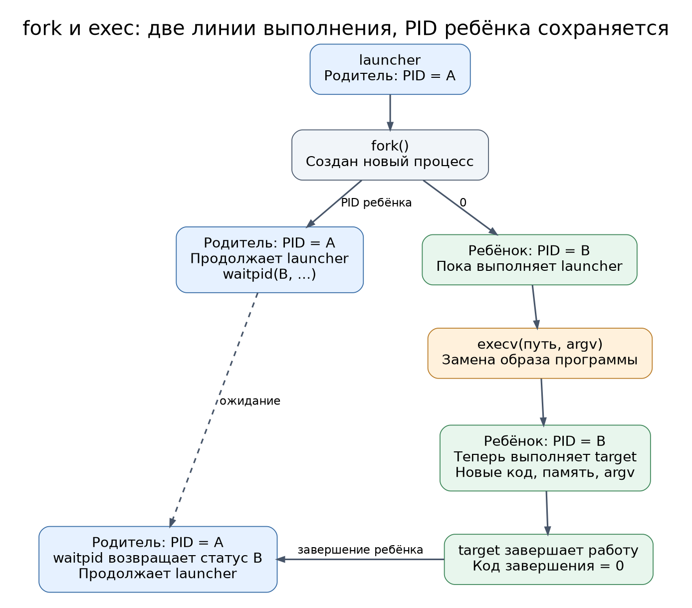

# Как Linux запускает программы: процессы, память, ELF, потоки и дескрипторы

##  Понятие процесса

Представьте текстовый редактор. На диске есть файл с машинными инструкциями редактора. Пока редактор не запущен, эти инструкции просто хранятся в файле. Они ничего не вычисляют.

Запустим редактор дважды и откроем в первом окне один документ, во втором — другой. Код редактора один и тот же, но содержание документов, положение курсора и история редактирования различаются. Значит, одного файла с инструкциями недостаточно, чтобы описать конкретное выполнение программы.

**Процесс** — это экземпляр выполняющейся программы, для которого ОС поддерживает контекст исполнения и набор ресурсов. Слово «выполняющейся» не означает, что прямо сейчас процесс обязательно использует CPU: он может ждать ввода, освобождения ресурса или своего очередного кванта процессорного времени.



У каждого из двух процессов есть свой **идентификатор (PID)**, свои изменяемые частные данные и состояние исполнения. ОС может остановить выполнение одного и продолжить другое. При этом неизменяемые страницы машинного кода из одного файла могут быть общими в физической памяти: отдельный процесс не означает, что ОС обязана буквально копировать весь исполняемый файл в RAM.

В Linux оболочка обычно создаёт дочерний процесс и запускает в нём нужный файл. Мы разберём создание потомка и замену исполняемой программы ниже.

### Ресурсы процесса

Вернёмся к редактору. Когда мы запустили его, потребовались не только инструкции, но и место для документа, доступ к открытому файлу, возможность получать время процессора, сведения о пользователе. ОС должна помнить всё необходимое, чтобы редактор мог работать, ждать и продолжать выполнение.

**Ресурсом процесса** называют предоставленный ОС объект или возможность, которыми процесс пользуется: например, отображённую память, открытый файл или процессорное время. Некоторые ресурсы принадлежат только одному процессу, другие могут быть разделены. У ресурсов есть стоимость: память занимает физические страницы при их использовании, вычисления расходуют CPU-время, открытые файлы требуют объектов ядра. Сама идентичность процесса и данные планировщика — это не пользовательские ресурсы в узком смысле, а служебные сведения, которые помогают ОС управлять ими.

| Что есть у процесса | Для чего нужно | Пример с редактором |
| --- | --- | --- |
| **Контекст исполнения** (регистры CPU, включая PC и SP) | Продолжать вычисления после паузы | Продолжить обработку очередного символа |
| **Виртуальное адресное пространство** | Размещать код, переменные и динамические данные | Хранить текст документа в памяти |
| **Открытые файловые дескрипторы** | Обращаться к файлам, терминалу, каналам, сокетам | Читать документ, записывать результат |
| **Процессорное время** | Выполнять машинные инструкции | Проверять орфографию, перерисовывать окно |
| **Рабочий каталог и корневой каталог** | Разрешать относительные и абсолютные пути | Открыть `notes.txt` относительно текущего каталога |
| **Учётные данные** (UID, GID, полномочия) | Проверять права доступа к ресурсам | Определить, разрешена ли запись в файл |
| **Идентификаторы, состояние, приоритет, учёт** | Найти процесс, планировать его и учитывать использование ресурсов | Различить два запущенных экземпляра редактора |

Различайте три вещи: **состояние CPU**, **память, доступную программе**, и **служебные данные ядра**, описывающие задачу и её ресурсы.

Ниже мы по очереди разберём эти части, а затем найдём их признаки у настоящего процесса.

### Адресное пространство: где лежат код и данные

Программа на C оперирует указателями. Когда мы пишем `int *p = malloc(sizeof(*p));`, значение `p` — адрес в **виртуальном адресном пространстве** процесса. Программа не выбирает напрямую номер физической ячейки RAM. ОС создаёт отображения виртуальных страниц, а аппаратный блок MMU (Memory Management Unit) с помощью таблиц страниц преобразует адреса при обращении к памяти.

Для нашей программы полезно выделить следующие области (подробно об этом - ниже):

- машинный код (обычно отображения исполняемого файла, в том числе секции `.text`);
- глобальные и статические объекты (`.data` для ненулевой инициализации, `.bss` для нулевой — типичное размещение);
- динамическая память: участки, которыми управляет `malloc`, в том числе в куче и анонимных отображениях;
- стек каждого потока: адреса возврата, часть локальных переменных и промежуточных данных;
- отображения библиотек, файлов и другие области `mmap`.



Важны две стрелки от страниц кода к одной физической странице и две разные страницы изменяемых данных. Например, виртуальный адрес `0x12345000` в процессе A и такой же виртуальный адрес в процессе B могут указывать на разные физические страницы. Поэтому изменение частной переменной в одном процессе не изменяет переменную другого. Существуют и намеренно общие отображения — их мы создадим ниже

Не весь виртуальный диапазон занят физической памятью: он содержит промежутки, отображения с разными правами доступа и страницы, которые могут быть ещё не загружены. Поэтому размер виртуальной памяти (`VmSize`) и объём резидентной памяти (`VmRSS`) не обязаны совпадать. RSS также не означает объём исключительно принадлежащей этому процессу RAM: общие страницы могут учитываться в RSS нескольких процессов.

### Состояние CPU: почему программа продолжается с места остановки

Представим одну вычислительную задачу, которая увеличивает счётчик, и вторую, которая читает документ. Если доступно только одно логическое ядро CPU, в конкретный момент оно исполняет инструкции только одной задачи. Linux планирует готовые к исполнению задачи и переключает их, например когда задача блокируется в ожидании ввода или когда планировщик решает предоставить CPU другой задаче.

Чтобы вернуться к первой задаче, недостаточно помнить её PID. Нужно сохранить точку продолжения и значения регистров. В частности:

- **PC / instruction pointer** — адрес инструкции, с которой следует продолжить выполнение (на x86-64 — `RIP`, на AArch64 — `PC`);
- **SP** — указатель стека (`RSP` на x86-64, `SP` на AArch64);
- остальные необходимые регистры, включая состояние вычислений и архитектурно-зависимые данные.



Когда задача A уступает CPU, ядро сохраняет необходимый контекст A, выбирает B и восстанавливает контекст B. Когда A вновь получит CPU, выполнение продолжится с сохранённого состояния, а не с начала `main()`. Это называется **переключением контекста**. Конкретная реализация зависит от архитектуры и причины перехода в ядро: часть контекста сохраняется на стеке ядра, часть — в архитектурно-зависимых структурах.

Состояние исполнения также включает информацию о том, может ли задача продолжать работу сейчас. Например, `R` в Linux обозначает выполняющуюся или готовую к выполнению задачу, `S` — задачу, спящую в прерываемом ожидании. Если редактор ждёт нажатия клавиши, он не обязан постоянно занимать CPU. Его адресное пространство и открытые файлы при этом сохраняются. На нескольких логических ядрах разные задачи могут выполняться одновременно.

### Как ядро Linux хранит сведения о задаче: `struct task_struct`

Теперь возникает вопрос: как ядро находит PID, память, открытые файлы и сохранённое состояние конкретной задачи? В Linux есть структура `task_struct`, представляющая планируемую задачу ([код ядра Linux на GitHub](https://github.com/torvalds/linux/blob/master/include/linux/sched.h)). Она содержит часть сведений непосредственно и ссылки на другие структуры ядра.



Откройте настоящий исходный код ядра: [`include/linux/sched.h`](https://github.com/torvalds/linux/blob/master/include/linux/sched.h). Найдите `struct task_struct {`, затем следующие поля. Это не публичный API пользовательского C-кода: состав структуры зависит от версии и конфигурации ядра.

| Поле / связанная структура | Что даёт ядру |
| --- | --- |
| `pid`, `tgid`, `real_parent` | Идентификатор задачи, группы потоков, связь с родителем |
| `__state`, `exit_state`, данные планировщика | Состояние исполнения и информацию для планирования |
| `mm` → `mm_struct` | Описание пользовательского адресного пространства; для задач ядра `mm` может быть `NULL` |
| `files` → `files_struct` | Таблицу файловых дескрипторов: число fd соответствует ссылке на открытый объект ядра |
| `fs` → `fs_struct` | Текущий рабочий каталог, корень и маску прав `umask` |
| `cred` → `cred` | Идентификаторы пользователя и группы, полномочия |
| `thread`, стек ядра и другие архитектурные структуры | Данные, необходимые для сохранения и восстановления контекста |

Например, чтобы прочитать открытый файл, программа передаёт ядру число файлового дескриптора. Ядро обращается к таблице файлов данной задачи, находит соответствующий открытый объект и выполняет чтение. Подробно мы рассмотрим это ниже.

Процесс и задача — не всегда одно и то же. До сих пор речь шла об однопоточном процессе. Linux планирует отдельные потоки (задачи), у каждого есть собственный `task_struct`, регистры и стек. У потоков одного процесса обычно общие адресное пространство и таблица дескрипторов. `getpid()` возвращает идентификатор группы потоков (TGID), `gettid()` — идентификатор текущей задачи (TID). У однопоточного процесса они совпадают. Многопоточное программирование - тема следующего семинара.

### Практика: найдём ресурсы у живого процесса

Откройте [`examples/01_process/process.c`](examples/01_process/process.c). В этой программе мы намеренно создаём объекты в разных областях памяти и печатаем сведения о процессе. Разберём её последовательно.

Сначала объявляются два глобальных объекта, локальная переменная и динамический объект:

```c
int global_initialized = 7;
int global_zero_initialized;
// ... внутри main:
int local = 11;
int *heap = malloc(sizeof(*heap));
// После проверки результата malloc:
*heap = 22;
```

Глобальные объекты существуют всё время выполнения программы. `local` обычно находится в стеке `main`, а `malloc` выделяет память, которой управляет распределитель памяти. Здесь `heap` — локальная переменная-указатель, `*heap` — объект в выделенной динамической памяти. Мы печатаем адрес объекта, а не адрес переменной-указателя. Выделение `malloc` не обязано каждый раз обращаться к ядру: распределитель может использовать ранее полученную память.

Далее `getpid()`, `getppid()` и `gettid()` дают PID процесса, PID его родителя и TID текущей задачи. Вызов `printf` с `%p` печатает виртуальные адреса объектов. Адреса часто отличаются между запусками из-за ASLR — рандомизации размещения областей памяти.

Наконец, программа открывает `/proc/self/status` через `fopen`. `/proc` — виртуальная файловая система, предоставляющая сведения ядра; `self` означает именно процесс, который обращается к этому пути. Программа читает интересующие строки через `fgets`. Открытый файл сам становится ресурсом процесса: за объектом `FILE *status` в библиотеке C стоит файловый дескриптор, номер которого можно получить через `fileno(status)`.

```bash
make build/01_process/process
./build/01_process/process
```

Пример вывода (PID, дескрипторы и адреса условны):

```text
PID=4121 PPID=4000 TID=4121
addresses: data=0x... bss=0x... stack=0x... heap=0x...
Name:   process
State:  R (running)
Tgid:   4121
Pid:    4121
PPid:   4000
Threads:        1
VmSize: ... kB
VmRSS:  ... kB
status fd=3
```

Здесь PID и TID совпадают, потому что поток один. `PPid` описывает родителя (обычно оболочку при непосредственном запуске). `State` — снимок состояния в момент чтения. `VmSize` и `VmRSS` относятся к адресному пространству; `status fd` — номер открытого дескриптора, он не обязан быть равен 3.

Программа по умолчанию сразу завершится. Чтобы исследовать процесс, пока он существует, запустите её в специальном режиме в **терминале 1**:

```bash
./build/01_process/process --inspect
```

Она выведет те же сведения, оставит файл `/proc/self/status` открытым и будет ждать Enter. Это обычное блокирующее чтение из `stdin` через `getchar()`: поток ждёт ввода, а его ресурсы остаются доступными для наблюдения. Не нажимайте Enter до конца эксперимента.

В терминале 2 подставьте PID из вывода первой программы (здесь `4121` — пример):

```bash
pid=4121
ps -p "$pid" -o pid,ppid,stat,comm
cat /proc/"$pid"/status | head -25
cat /proc/"$pid"/maps
ls -l /proc/"$pid"/fd
readlink /proc/"$pid"/cwd
```

Сопоставим команды с тем, что нарисовано на схемах:

| Команда | Что искать |
| --- | --- |
| `ps -p "$pid" -o pid,ppid,stat,comm` | PID, родителя, состояние (обычно `S` во время ожидания клавиши) |
| `cat /proc/"$pid"/status` | Число потоков, UID/GID, размеры памяти |
| `cat /proc/"$pid"/maps` | Виртуальные диапазоны, права `r/w/x`, файл, `[heap]`, `[stack]` |
| `ls -l /proc/"$pid"/fd` | Дескрипторы 0, 1, 2 (обычно терминал) и дескриптор открытого `status` |
| `readlink /proc/"$pid"/cwd` | Рабочий каталог процесса; он может отличаться от каталога второго терминала |

В `maps` каждая строка описывает виртуальный диапазон `[начало, конец)` в шестнадцатеричной записи, его права доступа и (если есть) имя отображённого файла. Найдите диапазоны, в которые попадают адреса `data`, `bss`, `stack`, `heap`, напечатанные программой. Глобальные данные могут находиться в одной области; маленький `malloc` обычно попадает в `[heap]`, но это не универсальное правило. `/proc` показывает отображения, а не конкретные физические адреса страниц.

В списке `fd` можно увидеть, что открытый нами `/proc/self/status` отображается как `/proc/<pid>/status`. Дескриптор `0` — стандартный ввод, `1` — стандартный вывод, `2` — стандартный поток ошибок (если они не были перенаправлены или закрыты). Эти записи описывают открытые объекты ядра, не буферы `stdio`.

Для проверки первой иллюстрации запустите ещё один экземпляр `./build/01_process/process --inspect` в терминале 3. Сравните PID, значения адресов и содержимое `/proc/<pid>/maps` и `/proc/<pid>/fd` у двух экземпляров. Программа одна, но процессы разные. В обоих выводах могут быть одинаковые номера дескрипторов, однако каждый номер интерпретируется в своей таблице. Адреса могут как совпадать, так и различаться; из этого нельзя заключить, что физические страницы одинаковые.

Затем нажмите Enter в каждом ожидающем экземпляре. `fclose(status)` закрывает файл, `free(heap)` освобождает динамический объект для повторного использования распределителем, а `return EXIT_SUCCESS` завершает программу. При обычном завершении ядро освобождает её адресное пространство и открытые дескрипторы; сведения о статусе завершения могут сохраняться до ожидания родителем (глава 3). Проверьте `ps -p "$pid"`: завершившийся и уже собранный оболочкой процесс больше не существует.

Обратите внимание: `cat /proc/self/status` в оболочке показывает состояние самого `cat`, а не нашего учебного процесса. Поэтому при наблюдении из другого терминала нужен конкретный PID.

## 2. Создаём дочерний процесс с помощью `fork`

Нам нужно породить ещё один процесс, который вначале имеет те же значения переменных, что родитель. Но что будет, если ребёнок изменит переменную: изменится ли значение в родителе? Чтобы ответить, используем `fork()`.

**Откройте [`examples/02_fork/fork.c`](examples/02_fork/fork.c).** До `fork()` процесс один. Его `value` равно 10; сначала он печатает собственный PID. Затем он вызывает `fork`, и две независимые последовательности выполнения продолжаются с одной и той же следующей строки исходного кода:

```c
pid_t child = fork();
if (child == -1) { /* ошибка: потомок не создан */ }
if (child == 0) { /* мы выполняемся в ребёнке */ }
/* сюда попадает родитель, у которого child == PID ребёнка (> 0) */
```

Это не «функция, вызываемая ребёнком», и не «две программы, выполняемые по очереди». `fork` создаёт новый процесс, а возвращаемое значение позволяет разделить их дальнейшую логику:

| Где выполняется строка | Что вернул `fork()` | Какой PID возвращает `getpid()` |
| --- | --- | --- |
| Родитель | положительный PID нового ребёнка | старый PID родителя |
| Ребёнок | `0` | собственный ненулевой PID ребёнка |
| Ошибка в родителе | `-1`, установлен `errno` | ребёнка нет |

В ветке `child == 0` код присваивает `value = 99` и завершает ребёнка через `_exit`. Родитель затем вызывает `waitpid(child, NULL, 0)` и только после этого печатает своё значение `value`. Пока воспринимайте `waitpid` как ожидание завершения именно этого ребёнка; подробности — в главе 3.

```bash
make build/02_fork/fork
./build/02_fork/fork
```

Ожидаемая логика вывода (PID будут другими):

```text
before fork: PID=5000 value=10
child: PID=5001 PPID=5000 value=99
parent: PID=5000 child=5001 value=10
```

`fork()` создаёт отдельное виртуальное адресное пространство ребёнка с теми же исходными содержимыми. Linux обычно реализует это через copy-on-write (COW): пока никто не меняет обычную частную страницу, оба процесса могут ссылаться на одну физическую страницу; при записи одному процессу ядро обеспечивает отдельную копию. Это экономит память и время запуска. Виртуальный адрес `&value` может совпадать у ребёнка и родителя, но одинаковое число адреса не означает, что изменения общие.

```text
                   fork()
             ┌─────────┴─────────┐
      Родитель, PID=A        Ребёнок, PID=B
      value=10               value=10 (сначала)
      своё адресное          своё адресное
      пространство           пространство
             │                     │
             │              value=99 (запись → COW)
             │                     │
      value по-прежнему 10   value становится 99
```

Зачем `fflush(stdout)` до `fork`? В `fork.c` сразу после первого `printf` принудительно очищается буфер `stdout`. В перенаправленном выводе `stdio` обычно буферизует строки; без `fflush` ребёнок мог бы унаследовать ещё не выведенные байты и напечатать их повторно. В ребёнке `fflush` вызывается ещё раз перед `_exit`: `_exit` завершает процесс, но не выполняет обычное обслуживание `stdio`, в отличие от `exit()`.

### Что наследуется, а что меняется при `fork`

| Свойство | У ребёнка | Что важно понять |
| --- | --- | --- |
| PID, PPID | Новый PID, PPID указывает на родителя | Два процесса различаются для ядра |
| Обычная память, стек, глобальные данные | Логически скопированные значения | Записи изолированы благодаря COW |
| Отображения `MAP_SHARED` | Наследуются и остаются связанными с той же общей областью | Это понадобится в главе 4 |
| Открытые файловые дескрипторы | Номера и записи таблицы наследуются | Но они ссылаются на **те же** open file descriptions; см. главу 8 |
| Текущий рабочий каталог и `umask` | Наследуются | Относительные пути продолжают иметь тот же смысл до изменений |
| Окружение | Значения копируются вместе с адресным пространством | Изменение в ребёнке не меняет окружение родителя |
| Счётчики времени CPU и некоторые учётные показатели | Начинаются заново | Ребёнок не «унаследовал уже потраченное CPU-время» |

Это не полный список наследуемых атрибутов; детали и исключения описаны в `man 2 fork`. В частности, `fork` из многопоточного процесса имеет дополнительные ограничения; к ним вернёмся после знакомства с потоками.

Вывод:`fork` создаёт независимый процесс, но не начинает выполнение с `main`: в обоих процессах управление возвращается из одного вызова `fork()`. Для общей памяти между процессами понадобится отдельный механизм. Перед ним надо понять, как корректно завершить и дождаться ребёнка.


## 3. `exit()`, `_exit()`, `wait()` и `waitpid()`

Проблема. Ребёнок выполнил работу. Как родителю узнать, что она завершилась, получить её результат и освободить учётную запись завершённого потомка в ядре? Простого факта, что ребёнок перестал исполнять код, недостаточно: родитель должен собрать статус.

Откройте [`examples/03_wait/wait.c`](examples/03_wait/wait.c). После `fork` ребёнок печатает сообщение и вызывает `exit(23)`. Родитель вызывает `wait(&status)`, затем проверяет результат.

Вспомните различие из предыдущей главы:

- `exit(23)` — функция библиотеки C: выполняет нормальное завершение (например, сбрасывает буферы `stdio`, вызывает зарегистрированные обработчики `atexit`) и в итоге завершает процесс.
- `_exit(23)` — более прямое завершение без пользовательского `stdio`-очищения. Поэтому оно подходит ребёнку после неудачной попытки `exec` и часто используется после `fork`.
- `return` из `main` при обычном выполнении эквивалентен вызову `exit` с возвращённым кодом.

Зачем в дочернем процессе использовать `fflush()` + `_exit()`:

- дублирование буферов ввода-вывода

При вызове `fork()` дочерний процесс получает точную копию адресного пространства родителя, включая содержимое пользовательских буферов `stdio` (например, текст, еще не записанный в файл из `stdout`). Если дочерний процесс вызовет обычный `exit()`, он сбросит эти буферы на диск.
Когда позже завершится родительский процесс и тоже вызовет `exit()`, он сбросит те же самые данные повторно. В итоге вы получите задублированный или «перемешанный» вывод в логах и файлах

- контроль над сбросом данных

Перед тем как сделать `fork()` (или перед вызовом `_exit()`), часто вызывают `fflush(NULL)` (или `fflush(stdout)`), чтобы принудительно очистить буферы родителя до размножения процесса. Это гарантирует, что накопившийся текст уже ушел в ядро/файл и не скопируется в дочерний процесс в удвоенном виде.

- Проблемы с `atexit()`

Если бы дочерний процесс вызвал `exit()`, он бы выполнил функции, зарегистрированные через `atexit()`. Эти функции могут попытаться удалить временные файлы, закрыть общие ресурсы или изменить состояние, предназначенное только для родительского процесса. `_exit()` обходит этот уровень абстракции библиотеки C и сразу передает управление ядру.

После завершения ребёнка ядру нужно некоторое время сохранять PID и код завершения, пока родитель их не заберёт: такое состояние называют **zombie**. `wait` или `waitpid` собирает информацию и позволяет освободить соответствующую запись. В нашем коде мы намеренно не создаём долгоживущего zombie, поэтому обычно увидеть его через `ps` не получится.

Разберите четыре ключевые строки `wait.c`:

```c
pid_t reaped = wait(&status);     /* ждём одного из своих детей */
if (reaped == -1) { /* ошибка */ }
if (WIFEXITED(status)) {          /* завершился обычным образом? */
    printf("...%d...", WEXITSTATUS(status)); /* код 23 */
}
```

`status` не равен `23`: это кодированное представление результата ожидания. Нельзя просто печатать `status` как код выхода. `WEXITSTATUS(status)` допустим только при истинном `WIFEXITED(status)`. Возвращаемое значение `wait` — PID собранного потомка, а не код завершения. Если детей нет, вызов завершится ошибкой с подходящим `errno`.

```bash
make build/03_wait/wait
./build/03_wait/wait
```

Ожидаемые содержательные строки:

```text
child: exit(23) ends this process
parent: reaped=... exit=23
```

Почему глава 2 использовала `waitpid`, а здесь `wait`? `wait(&status)` ждёт *любого* подходящего дочернего процесса. `waitpid(child_pid, &status, 0)` позволяет указать конкретного ребёнка; параметр `0` означает обычное блокирующее ожидание. В главе 2 было достаточно дождаться потомка, поэтому второй аргумент — `NULL` (статус не нужен). Общая задача обеих функций — ожидание и сбор результата; `waitpid` удобнее, когда потомков несколько.

Механика жизненного цикла: `fork → работа ребёнка → exit/_exit → wait/waitpid родителя`.


## 4. `mmap(MAP_SHARED)`: намеренно делаем память общей

Задача. В главе 2 `value = 99` у ребёнка не изменило `value` у родителя. Теперь нам нужна переменная, записанное ребёнком значение которой прочитает родитель. При этом оба остаются отдельными процессами. Для этого подходит общее отображение памяти.

Откройте [`examples/04_shared_mmap/shared_mmap.c`](examples/04_shared_mmap/shared_mmap.c). Здесь заранее создаются два объекта:

```c
int private_value = 10;    /* обычная локальная переменная */
int *shared_value = mmap(NULL, sizeof(*shared_value), PROT_READ | PROT_WRITE,
                         MAP_SHARED | MAP_ANONYMOUS, -1, 0);
```

`mmap` отображает область в виртуальное адресное пространство вызывающего процесса.

| Аргумент | Значение в коде | Зачем |
| --- | --- | --- |
| `addr` | `NULL` | Ядро само выбирает виртуальный адрес |
| `length` | `sizeof(*shared_value)` | Хотим хранить минимум один `int`; реально отображение управляется с гранулярностью страниц |
| `prot` | `PROT_READ \| PROT_WRITE` | Разрешаем чтение и запись через указатель |
| `flags` | `MAP_SHARED \| MAP_ANONYMOUS` | Область общая, а не привязанная к обычному файлу |
| `fd` | `-1` | Для анонимного отображения файловый дескриптор не нужен |
| `offset` | `0` | Для анонимного отображения смещение не используется |

При ошибке `mmap` возвращает `MAP_FAILED`; успешное отображение нужно убрать через `munmap`.

Как проходит эксперимент:

1. До `fork` родитель создаёт `MAP_SHARED | MAP_ANONYMOUS` и записывает `*shared_value = 10`. Поскольку отображение уже существует, ребёнок его наследует и обе стороны используют один общий объект памяти.
2. После `fork` ребёнок присваивает обычной `private_value` значение 99, а `*shared_value` — 42.
3. Ребёнок завершает работу через `_exit`, предварительно выводя значения.
4. Родитель ждёт `waitpid`, после чего читает собственную `private_value` и содержимое общей области. Затем `munmap` удаляет отображение у родителя.

```bash
make build/04_shared_mmap/shared_mmap
./build/04_shared_mmap/shared_mmap
```

```text
child: private=99 shared=42
parent: private=10 shared=42
```

Почему это работает? У обычной локальной переменной после `fork` — отдельное логическое состояние и COW. У `MAP_SHARED` наследуемые отображения ссылаются на один объект; запись одной стороны становится видимой другой. Равные виртуальные адреса указателей не доказывают совместное использование (в главе 2 адреса также могли совпадать). Существен именно тип и источник отображения.

Особенно важно: `MAP_SHARED` не упорядочивает действия сам по себе. Если бы родитель начал читать одновременно с записью ребёнка, для корректной координации потребовались бы межпроцессные средства синхронизации. Мы делаем проще: `waitpid` обеспечивает, что ребёнок уже закончил запись, прежде чем родитель читает. 

Сравнение с другими вариантами `mmap`: `MAP_PRIVATE` создаёт частное COW-отображение; `MAP_SHARED` даёт общую область. `MAP_ANONYMOUS` означает отсутствие обычного файла. Поэтому файловый `MAP_SHARED` тоже возможен — разные процессы могут отображать одни и те же диапазоны файла. Если же два независимых процесса каждый сам вызовет `mmap(..., MAP_SHARED | MAP_ANONYMOUS, ...)`, общей памяти между ними от этого не появится: у каждого будет свой анонимный объект. В нашем примере они разделяют один объект, потому что отображение создано до `fork`.

Вывод. Изоляция памяти после `fork` — правило по умолчанию, а `MAP_SHARED` даёт контролируемое исключение. Далее разберём другую возможность: процесс сохранит идентичность, но полностью заменит исполняемую программу.


## 5. `exec`: как запустить другую программу

Представьте, что вы вводите в терминале `ls -l`. Оболочке нужно запустить `ls`, дождаться её завершения и снова принимать команды. Для этого оболочка может создать дочерний процесс через `fork()`, а в ребёнке вызвать `exec`, чтобы начать выполнение другой программы.

### 5.1. Что происходит при `exec`

Откройте [`launcher_execv.c`](examples/05_exec/launcher_execv.c) и [`target_execv.c`](examples/05_exec/target_execv.c). Это две самостоятельные программы, каждая со своим `main`. Первая запускает вторую.

```bash
make
./build/05_exec/launcher_execv
```



Проследим за кодом launcher:

1. `fork()` создаёт ребёнка. Оба процесса пока выполняют программу launcher.
2. Родитель вызывает `waitpid(child, &status, 0)` и ждёт завершения ребёнка.
3. Ребёнок вызывает `execv`. Ядро заменяет его код, данные, стек, кучу и другие отображения памяти образом программы target. **PID ребёнка остаётся прежним.** Начинается выполнение новой программы.
4. Target печатает свои PID, аргументы и окружение, затем завершается. Родитель получает код завершения ребёнка.

Важный момент: родитель и ребёнок выполняются независимо, поэтому ожидание может начаться до вызова `execv`.

Сравните несколько строк вывода (числа PID будут другими):

```text
launcher: parent PID=4100
launcher: child PID=4101 before execv
launcher: exec path=./build/05_exec/target_execv
 target: PID=4101 PPID=4100
...
launcher: child 4101 exit=0
```

**`fork()` создаёт процесс, а `exec` заменяет программу в существующем процессе.** Успешный вызов `exec` не возвращается в прежний `main`. Именно поэтому после него в коде launcher стоят `perror` и `_exit(127)`: они выполняются только при ошибке запуска. Код 127 — выбранное нами обозначение ошибки, а не результат, возвращаемый самим `exec`.

### 5.2. `execv`: путь к файлу и аргументы программы

Посмотрим на ключевые строки в [`launcher_execv.c`](examples/05_exec/launcher_execv.c) (путь в исходнике хранится в переменной `path`):

```c
char *const args[] = {"target_execv", "hello", "42", NULL};
execv("./build/05_exec/target_execv", args);
```

Первый параметр — путь к исполняемому файлу. Второй — массив строк, которые получит `main` новой программы. Например, команда `ls -l /tmp` передаёт программе аргументы `"ls"`, `"-l"` и `"/tmp"`.

В [`target_execv.c`](examples/05_exec/target_execv.c) цикл печатает массив `argv`, переданный из launcher:

```text
 target: argc=3
 target: argv[0]=target_execv
 target: argv[1]=hello
 target: argv[2]=42
```

`argv[0]` по соглашению содержит имя программы, но не определяет, какой файл будет запущен: его выбирает первый аргумент `execv`. Последний указатель массива `args` — `NULL`, признак конца массива; в `argc` он не учитывается.

### 5.3. Что такое окружение программы

Помимо аргументов, программа получает **переменные окружения** — именованные текстовые настройки в виде строк `ИМЯ=значение`. Например, `HOME` обычно содержит путь к домашнему каталогу, а `PATH` — список каталогов для поиска программ.

Посмотрим на окружение в терминале:

```bash
printenv HOME
printenv PATH
```

Можно передать собственную настройку только одному запуску программы:

```bash
LESSON_LABEL=from-shell ./build/05_exec/launcher_execv
```

В [`target_execv.c`](examples/05_exec/target_execv.c) функция `print_env` читает значение через `getenv(name)`. Если переменной нет, `getenv` возвращает `NULL`. В выводе увидим:

```text
 target: LESSON_LABEL=from-shell
```

Почему target получил настройку, которую мы передали launcher? Ребёнок наследует окружение при `fork()`, а `execv` передаёт его новой программе. Окружение — не глобальная таблица всех процессов. Чтобы сделать настройку доступной последующим запускам из текущей оболочки, можно выполнить `export LESSON_LABEL=from-shell`.

Не путайте окружение с аргументами: `argv[1]` по-прежнему равно `hello`, а значение `LESSON_LABEL` читается отдельно через `getenv`.

### 5.4. `execvp`: ищем программу по имени через PATH

Зачем нужен `PATH`? Когда вы вводите `ls`, вы обычно не знаете или не пишете полный путь к файлу. `PATH` содержит каталоги, разделённые двоеточиями. Например, при `PATH=/usr/local/bin:/usr/bin:/bin` поиск идёт в этом порядке: `/usr/local/bin/ls`, `/usr/bin/ls`, `/bin/ls`.

Откройте [`launcher_execvp.c`](examples/05_exec/launcher_execvp.c) и [`target_execvp.c`](examples/05_exec/target_execvp.c). Теперь первый аргумент — только имя файла:

```c
char *const args[] = {"target_execvp", "hello", "42", NULL};
execvp("target_execvp", args);
```

Наш target находится в `build/05_exec`. Добавим этот каталог в начало PATH для запуска launcher (`$PWD` — текущий каталог):

```bash
PATH="$PWD/build/05_exec:$PATH" ./build/05_exec/launcher_execvp
```

Target успешно запускается. Если указать несуществующий каталог, поиск завершится ошибкой, а launcher напечатает `exit=127`:

```bash
PATH=/nonexistent ./build/05_exec/launcher_execvp
```

**Разница:** `execv` использует указанный путь напрямую, а `execvp` ищет файл по PATH, если имя не содержит `/`. Обе функции передают target текущее окружение.

### 5.5. `execve`: задаём окружение новой программы

До сих пор target наследовал окружение. А что делать, если мы хотим сами выбрать его настройки?

Откройте [`launcher_execve.c`](examples/05_exec/launcher_execve.c) и [`target_execve.c`](examples/05_exec/target_execve.c). В `execve` появляется третий параметр — массив строк окружения `envp`:

```c
char *const args[] = {"target_execve", "hello", "42", NULL};
char *const envp[] = {
    "LESSON_LABEL=from-envp",
    "PATH=./build/05_exec",
    NULL
};
execve("./build/05_exec/target_execve", args, envp);
```

`args` — аргументы программы, `envp` — **полное новое окружение**, а не дополнение к старому. Оба массива заканчиваются `NULL`.

Передадим launcher другие значения:

```bash
LESSON_LABEL=from-shell PARENT_ONLY=keep ./build/05_exec/launcher_execve
```

Target напечатает:

```text
 target: LESSON_LABEL=from-envp
 target: PARENT_ONLY=(unset)
 target: PATH=./build/05_exec
```

`LESSON_LABEL` заменена значением из `envp`, а `PARENT_ONLY` отсутствует, потому что её нет в новом массиве.

**Важно:** `execve` не ищет программу по PATH, даже если PATH присутствует в `envp`. Это настройка будущей программы, а не инструкция ядру найти файл. Проверим предусмотренным в launcher режимом `--name-only`, который передаёт `execve` строку `"target_execve"` вместо пути:

```bash
PATH="$PWD/build/05_exec" ./build/05_exec/launcher_execve --name-only
```

Из корня проекта получим ошибку: `execve` пытается открыть файл `target_execve` в текущем каталоге, а не в `build/05_exec`. Именно поиск по каталогам отличает `execvp` от `execve`.

### 5.6. Остальные три варианта: аргументы списком

`execl`, `execlp` и `execle` делают то же, что рассмотренные функции, но вместо массива `args` принимают строки отдельными параметрами. Список заканчивается `(char *)NULL`. В `execle` после этого указателя передаётся `envp`.

| Функция | Пример вызова | Исходники |
| --- | --- | --- |
| `execl` | `execl(path, "target_execl", "hello", "42", (char *)NULL)` | [launcher](examples/05_exec/launcher_execl.c), [target](examples/05_exec/target_execl.c) |
| `execlp` | `execlp("target_execlp", "target_execlp", "hello", "42", (char *)NULL)` | [launcher](examples/05_exec/launcher_execlp.c), [target](examples/05_exec/target_execlp.c) |
| `execle` | `execle(path, "target_execle", "hello", "42", (char *)NULL, envp)` | [launcher](examples/05_exec/launcher_execle.c), [target](examples/05_exec/target_execle.c) |

В этих программах `path` и `envp` определены так же, как в предыдущих примерах, с соответствующим именем target. Запустим три launcher:

```bash
./build/05_exec/launcher_execl
PATH="$PWD/build/05_exec:$PATH" ./build/05_exec/launcher_execlp
./build/05_exec/launcher_execle
```

Все target получают три аргумента. У `execle`, как и у `execve`, окружение определяется массивом `envp`.

### 5.7. Как выбрать нужную функцию

| Функция | Аргументы | Поиск по PATH | Окружение |
| --- | --- | --- | --- |
| `execv` | массив | нет | текущее |
| `execvp` | массив | да, для имени без `/` | текущее |
| `execve` | массив | нет | заданное `envp` |
| `execl` | список | нет | текущее |
| `execlp` | список | да, для имени без `/` | текущее |
| `execle` | список | нет | заданное `envp` |

Буквы помогают запомнить различия: `v` — vector (массив), `l` — list (список), `p` — path (поиск по PATH), `e` — environment (явное окружение). `execve` — системный вызов Linux, остальные пять — библиотечные интерфейсы.

При успешном `exec` PID и рабочий каталог сохраняются, а образ программы заменяется. Открытые дескрипторы без `FD_CLOEXEC` также сохраняются — это пригодится в главе 8. В следующей главе рассмотрим ELF-файл, из которого ядро загружает новую программу.