# Введение в многопоточное программирование на C: от первого потока до lock-free стека

## План

| Шаг | Тема | Где код |
|---|---|---|
| 0 | Что такое поток, где его данные, `create`/`join` | `src/00_threads.c` |
| 1 | Race condition, data race, mutex | `src/01_counter.c` |
| 2 | Атомарные операции, CAS | `src/02_atomics.c` |
| 3 | Ожидание данных, `pthread_cond_t`, потерянное уведомление | `src/03_condition.c` |
| 4 | Как ожидание устроено ближе к ядру Linux, futex | `src/04_futex.c` |
| 5 | CAS-стек, lock-free, ABA | `src/05_stack.c`, `src/06_aba.c` |
| Дополнение | Аналогичные средства в C++17 | `cpp/` |

## Сборка

- Linux (на macOS `futex` и `pthread_barrier_t` может быть недоступен)

```bash
make                  # собрать программы C и C++
make test             # проверить все воспроизводимые сценарии
./build/00_threads    # запустить самый первый пример
```

В Makefile используются `-std=c11 -pthread` (для C) и `-std=c++17 -pthread` (для C++). Опция `-pthread` важна: она сообщает компилятору и компоновщику, что программа использует потоки.

---

## 0. Понятие потока

### Обычная программа и два независимых исполнителя

В обычном последовательном коде действия идут одно за другим:

```c
int a = read_number();
int b = calculate(a);
printf("%d\n", b);
```

Теперь представим службу доставки: один сотрудник принимает заказы, а второй собирает товары для каждого принятого заказа. Если программа всё делает последовательно, пока первый ожидает сеть, второй не занимается сборкой. Можно запустить два потока выполнения внутри одного процесса: они исполняют разные функции или разные экземпляры одной функции, а данные о заказах держат в общей памяти.

**Процесс** — запущенная программа с собственным адресным пространством и ресурсами ОС. **Поток** (**thread**) — отдельный путь выполнения инструкций внутри процесса: у него свои регистры, стек вызовов и положение в коде, но память процесса в целом общая.

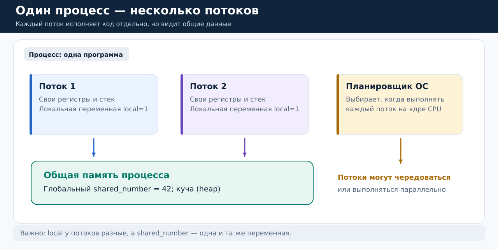

*Рисунок 1.* Синие и фиолетовые блоки — отдельные потоки. У каждого собственный `local_counter`; глобальный `shared_number` один на всех. На схеме это логическое разделение, а не физические границы памяти: при неправильной передаче указателя поток может обратиться и к стеку другого потока. Поэтому точнее говорить, что *стек каждого потока выделяется ему отдельно*, но память процесса доступна другим потокам при наличии адреса.

Важно различать три случая:

- `int local = 0;` внутри функции потока — каждый вызов функции получает собственный объект `local`.
- Глобальная переменная `int counter;` — один общий объект для всех потоков процесса.
- Память, выделенная с помощью `malloc`, принадлежит процессу, а не автоматически какому-то одному потоку. Два потока могут получить адрес одного блока.

Это не значит, что каждый поток имеет отдельную копию любой переменной, к которой он обращается. Если два потока получают один адрес `int *p`, они обращаются к одному объекту.

### Как работают ядра CPU и планировщик

ОС решает, какой поток сейчас выполняется на каком логическом процессоре. На одном доступном CPU потоки **конкурентны** (**concurrent**): ОС может прервать один и запустить другой. На двух CPU они могут выполняться **параллельно** (**parallel**). В обоих случаях порядок обращений к общей памяти заранее не определён.

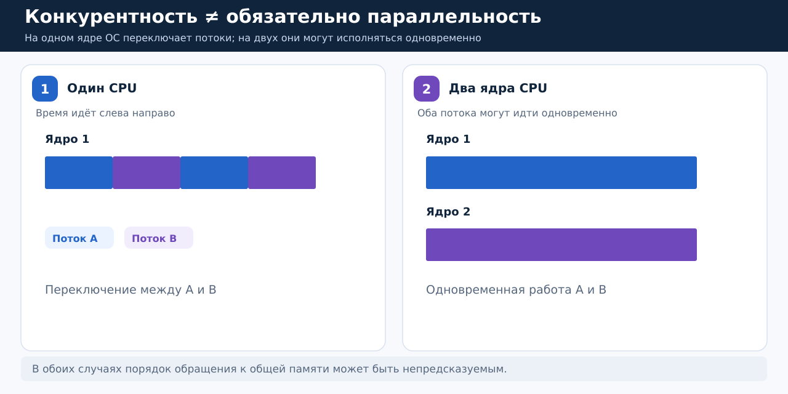

*Рисунок 2.* Слева короткие цветные отрезки — переключения между потоками A и B на одном CPU. Справа потоки могут исполняться одновременно на разных CPU. Переключение не обязательно происходит в границах строк исходного кода, а операционная система не обязана каждый раз выбирать один порядок.

Вывод: программа должна быть корректна при любом допустимом порядке выполнения потоков, а не только при том, который случайно возник при первом запуске.

### Минимальная программа с `pthread_create` и `pthread_join`

Откройте `src/00_threads.c`. В нём два потока выполняют одну функцию `thread_work`:

```c
void *thread_work(void *argument) {
    int id = *(int *)argument; // У каждого потока свой номер.
    int local_counter = 0;    // Отдельная локальная переменная.

    for (int step = 0; step < 3; ++step) {
        ++local_counter;
        printf("thread=%d step=%d local=%d shared=%d\n",
               id, step + 1, local_counter, shared_number);
    }
    return NULL;
}
```

Параметр `void *argument` — произвольный указатель, через который `main` передаёт данные потоку. Здесь он указывает на `int` с номером. Сигнатура `void *(*)(void *)` требуется интерфейсом `pthread_create`.

В `main` происходят два разных действия:

```c
pthread_t threads[2];
int ids[2] = {1, 2};

for (int i = 0; i < 2; ++i) {
    pthread_create(&threads[i], NULL, thread_work, &ids[i]);
}
for (int i = 0; i < 2; ++i) {
    pthread_join(threads[i], NULL);
}
```

`pthread_create` запускает новый поток и возвращается, не ожидая его окончания. `pthread_join` ждёт завершения конкретного потока. Второй аргумент `pthread_create` (`NULL`) означает стандартные атрибуты. Четвёртый аргумент передаётся внутрь `thread_work`.

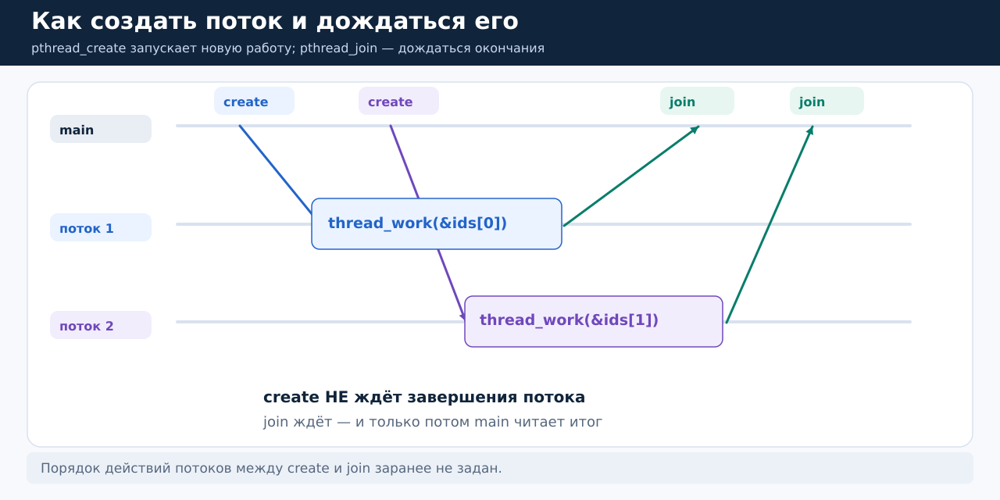

*Рисунок 3.* Основной поток создаёт две независимые работы. Они могут начаться и закончиться в разном порядке. Лишь после двух `join` основной поток знает, что обе завершились.

```bash
./build/00_threads
```

В выводе должны появиться по три строки для каждого `thread=1` и `thread=2`, затем `main: both threads joined`. Порядок первых шести строк может меняться. При этом `local` для каждого потока самостоятельно пробегает `1, 2, 3`, а `shared=42` всегда одинаковый, поскольку его никто не изменяет.

Распространённая ошибка: в цикле создания потоков передавать всем `&i`, где `i` — *одна* меняющаяся переменная цикла. Тогда разные потоки одновременно обращаются к одному `i`, и его изменение в `main` без синхронизации вызовет data race (об этом ниже). Здесь используется массив `ids`: у каждого потока свой неизменяемый после создания элемент, время жизни которого длится до `join`.

### Та же идея в C++

```cpp
#include <thread>

std::thread worker([] { /* работа отдельного потока */ });
worker.join();
```

В C++ `std::thread` соответствует базовой идее `pthread_create` + `pthread_join`. Объект `std::thread` нельзя просто уничтожить, пока он остаётся `joinable`: деструктор тогда вызывает `std::terminate`. Полный пример с двумя потоками и защитой общего счётчика - в `cpp/01_basics.cpp`.

---

## 1. Первая проблема: оба потока изменяют один счётчик

Теперь новый заказ означает команду «увеличь общее число заказов на 1». Допустим, на общей доске написано `5`. Два работника получают по одному заказу. Правильный итог — `7`.

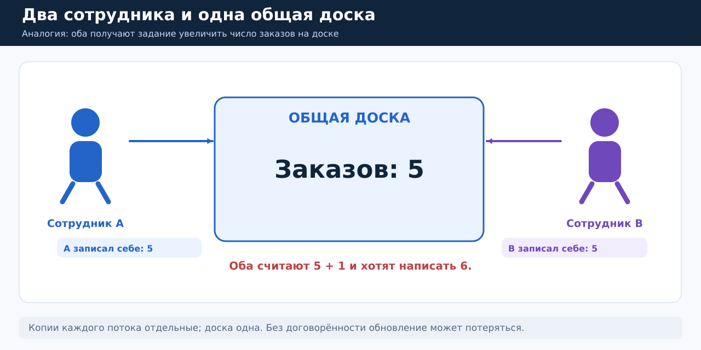

*Рисунок 4.* У каждого сотрудника свой листок с прочитанным значением `5`, но общая доска одна. Если оба на основе этой копии независимо вычислят `6` и запишут его, один заказ потеряется.

### Откуда берётся потерянное обновление

Можно мысленно разложить `++counter` на три логических этапа: прочитать старое значение → вычислить новое → записать.

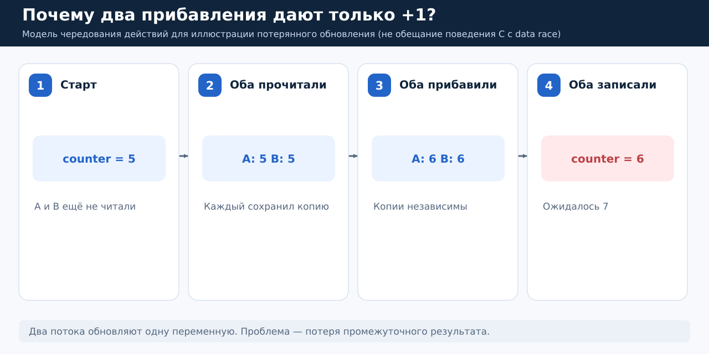

*Рисунок 5.* Этап 1: `counter=5`. Этап 2: A и B независимо читают `5`. Этап 3: оба вычисляют `6`. Этап 4: оба записывают `6`; вместо желаемого `7` получаем `6`.

Код из `src/01_counter.c` создаёт четыре потока, каждый пытается выполнить 100 000 увеличений:

```c
uint64_t plain_counter = 0; // Один общий объект.

void *increment(void *unused) {
    (void)unused;
    for (int i = 0; i < 100000; ++i) {
        ++plain_counter; // ОШИБКА, если несколько потоков делают это без защиты.
    }
    return NULL;
}
```

Ожидание: `4 × 100000 = 400000`. Но при одновременных несинхронизированных изменениях код нарушает правила модели памяти C.

```bash
./build/01_counter unsafe
```

Здесь возможен даже вывод `400000` — это не доказывает корректность. Программа имеет undefined behavior.

### Два похожих, но разных термина

**Race condition (состояние гонки)** — логическая ситуация, в которой результат зависит от того, кто и когда выполнил действия. Не всякая зависимость от расписания обязательно ошибка: например, порядок диагностических строк двух потоков не фиксирован, но приемлем.

**Data race (гонка данных)** — более конкретное нарушение правил языка: два потока обращаются к одной области памяти без нужного упорядочивания, хотя бы одно обращение изменяет её, и они не являются согласованными атомарными операциями. В C такая гонка приводит к undefined behavior. Это один из видов race condition.

| Ситуация | Data race? | Что важно |
|---|---|---|
| Два потока только читают неизменяемый `shared_number` | Нет | Нет конфликтующей записи |
| Два потока выполняют обычное `++plain_counter` | Да | Запись и чтение/запись не синхронизированы |
| Два потока атомарно читают 0, потом атомарно записывают 1 | Нет | Может быть логическая race condition; см. следующий раздел |
| Два потока входят в одну критическую секцию с одним mutex | Нет, если все обращения защищены | Операции выполняются по очереди |

То есть data race означает, что сам способ обращения к памяти незаконен по правилам C. Race condition означает, что алгоритм может дать не тот результат из-за порядка шагов; даже при использовании атомиков можно написать алгоритм с логической ошибкой (см. ниже).

### Мьютекс: один ключ от общей доски

Если несколько сотрудников должны менять одну доску, выдадим один ключ от помещения с ней. Кто получил ключ, тот может прочитать число, прибавить и записать. Остальные ждут. Такой «ключ» в программе — **mutex** (**mutual exclusion**, взаимное исключение).

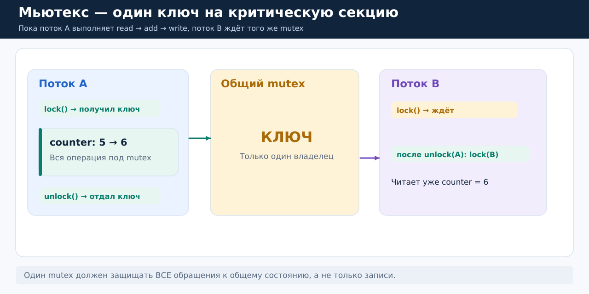

*Рисунок 6.* A захватил mutex и целиком выполнил операцию `5 → 6`. B не может войти в ту же защищённую секцию, пока A не вызовет `unlock`. После этого B читает уже `6` и получает `7`.

В C используем POSIX Threads:

```c
#include <pthread.h>

pthread_mutex_t counter_mutex = PTHREAD_MUTEX_INITIALIZER;

pthread_mutex_lock(&counter_mutex); // Если занят — ждём.
++plain_counter;                   // Критическая секция.
pthread_mutex_unlock(&counter_mutex); // Разрешаем следующему потоку.
```

**Критическая секция** — область кода, где поток обращается к общему состоянию, которому нельзя позволить конфликтующее изменение. В этом примере она очень короткая, но в других задачах может изменять сразу несколько связанных полей.

Обратите внимание на две принципиальные детали.

1. Mutex должен быть одним и тем же объектом для всех потоков. Если каждый создаст собственный `pthread_mutex_t`, они не будут друг другу мешать.
2. Договорённости должны придерживаться все*обращения к защищённому состоянию. Нельзя писать под mutex, а в другой функции одновременно читать ту же обычную переменную без mutex.

Проверим:

```bash
./build/01_counter mutex
# mode=mutex expected=400000 observed=400000
```

В `src/01_counter.c` сравните обе ветки `increment()`. Сами операции увеличения идентичны. Исправление только в добавлении `pthread_mutex_lock` и `pthread_mutex_unlock` вокруг всего обновления.

Отличие от `pthread_join`: mutex защищает данные во время совместной работы. `pthread_join` позволяет основному потоку дождаться момента, когда эта работа уже завершилась.

Чего mutex не решает автоматически: если поток захватил mutex и забыл освободить его, другие могут ждать бесконечно. Если два потока захватывают два разных mutex в разном порядке, возможно взаимное ожидание (*deadlock*). Если держать mutex при долгом вводе-выводе, остальные будут ждать дольше необходимого.

### Тот же mutex в C++

`cpp/01_basics.cpp` повторяет идею на `std::thread` и `std::mutex`:

```cpp
std::mutex mutex;
int counter = 0;

// В каждом потоке:
{
    std::lock_guard<std::mutex> lock(mutex);
    ++counter;
} // lock автоматически освободит mutex.
```

`std::lock_guard` — небольшой объект, который берёт mutex в конструкторе и освобождает в деструкторе. Так разработчик не забудет `unlock` при раннем выходе из блока. В C нет такого автоматического механизма RAII, поэтому нужно явно освобождать mutex на всех путях выхода.

```bash
./build/cpp_01_basics
# C++ counter=2000 expected=2000
```

---

## 2. Атомарные операции: можем ли обойтись без mutex для одного числа?

Требование изменилось. Для одного счётчика каждый раз захватывать mutex кажется избыточным. C11 предлагает **атомарные объекты** (**atomics**): операции над ними имеют специальную определённую стандартом семантику и не образуют data race друг с другом при корректном использовании.

```c
#include <stdatomic.h>

atomic_int counter = ATOMIC_VAR_INIT(0);
```

Это всё ещё одна переменная для всех потоков, но для неё есть атомарные чтение, запись и изменение:

- `atomic_load(&counter)` — прочитать текущее значение;
- `atomic_store(&counter, 5)` — записать `5`;
- `atomic_fetch_add(&counter, 1)` — выполнить атомарное увеличение и вернуть **старое** значение;
- `atomic_compare_exchange_weak(...)` — попытаться атомарно заменить значение при выполнении условия.

Слово **атомарно** означает, что другие атомарные операции не увидят промежуточную часть конкретной операции. Но это не означает, что произвольная последовательность из нескольких вызовов стала неделимой.

### Ловушка: отдельные атомарные load и store

Попробуем исправить плохой счётчик простой заменой доступа на атомарный:

```c
int snapshot = atomic_load_explicit(&counter, memory_order_relaxed);
/* Поток может уступить CPU. */
atomic_store_explicit(&counter, snapshot + 1, memory_order_relaxed);
```

Оба обращения атомарные. Тем не менее оба потока могут получить `snapshot=0` и оба записать `1`.

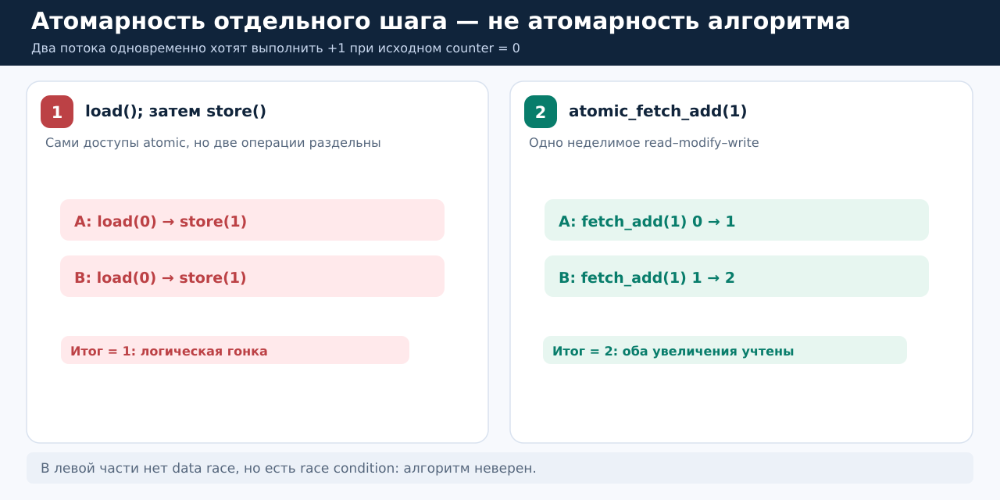

*Рисунок 7.* Слева две отдельные операции каждого потока не защищают всю пару. Справа `fetch_add` выполняет целое увеличение неделимо и учитывает обе прибавки.

В `src/02_atomics.c`, функции `split_worker()`, используется `pthread_barrier_wait(&both_loaded)` — **барьер**. Его роль исключительно учебная: ни один из двух потоков не выходит из барьера, пока оба не дошли до него. Здесь он поставлен после чтения, поэтому оба потока гарантированно читают `0` до записи. Это помогает воспроизвести ошибку.

```bash
./build/02_atomics split
# mode=split value=1 ...
```

Итог: data race уже нет, но race condition остаётся.

### Готовая операция read–modify–write

Если нужна только прибавка, выбираем `atomic_fetch_add`:

```c
atomic_fetch_add_explicit(&counter, 1, memory_order_relaxed);
```

Весь переход «получить старое значение, прибавить, записать» выполняется как одна атомарная операция. Выполнившиеся прибавления не теряются. Конструкция `_explicit` нужна для указания порядка памяти, о котором пока достаточно знать лишь следующее: `memory_order_relaxed` гарантирует атомарность счётчика, но не делает этот счётчик сигналом готовности других данных.

```bash
./build/02_atomics fetch
# mode=fetch value=400000 ...
```

Для нашего обычного счётчика `relaxed` подходит. Позже, когда через атомарный указатель будем передавать готовый узел, понадобятся дополнительные гарантии `release/acquire`.

### CAS: проверка и замена как единое действие

А если требуется не просто `+1`, а изменить значение только при условии, что с момента чтения его никто не поменял? Появляется **CAS** (**compare-and-swap**, сравнить и заменить).

В человеческих словах: «Я запомнил, что на доске `0`. Замени его на `1` только если там до сих пор `0`. Иначе скажи, что там теперь написано».

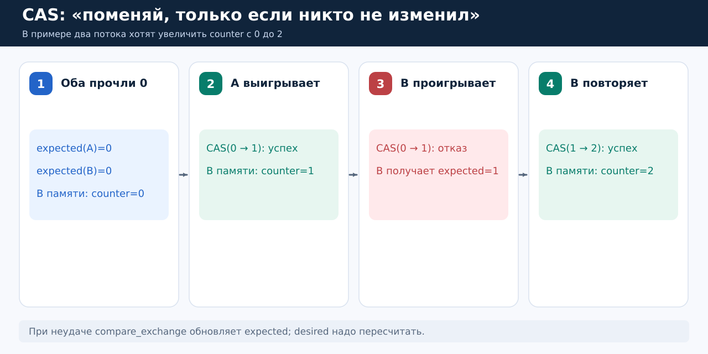

*Рисунок 8.* (1) Оба потока запомнили `0`. (2) A удачно заменил `0 → 1`. (3) B проверяет старый `0`, но в памяти уже `1`: замена **не выполняется**, а локальный `expected` становится `1`. (4) B повторяет операцию `1 → 2`; оба увеличения учтены.

Откройте `cas_worker()` в `src/02_atomics.c`:

```c
int expected = atomic_load_explicit(&counter, memory_order_relaxed);

while (!atomic_compare_exchange_weak_explicit(
    &counter, &expected, expected + 1,
    memory_order_relaxed, memory_order_relaxed)) {
    /* Неуспех: expected автоматически обновился; повторяем. */
}
```

Разберём параметры по одному:

| Аргумент | Смысл |
|---|---|
| `&counter` | Адрес общей атомарной переменной |
| `&expected` | Адрес локальной переменной с ожидаемым старым значением |
| `expected + 1` | Новое значение, которое хотим записать при успехе |
| Первый `memory_order_relaxed` | Порядок памяти для успешной операции |
| Второй `memory_order_relaxed` | Порядок памяти для неуспеха |

При успехе CAS возвращает `true` и заменяет `counter`. При неуспехе возвращает `false`, `counter` не меняет, но записывает наблюдаемое значение в `expected`. Поэтому в следующей итерации `expected + 1` уже означает другую величину.

`compare_exchange_weak` может вернуть `false` даже без конкурирующего изменения (**spurious failure**). Поэтому его удобно использовать в цикле. Это другое явление, не «ложное пробуждение» condition variable. Для одиночной попытки существует `compare_exchange_strong`, но если данные действительно меняются другими потоками, даже с ним обычно нужна логика повторов.

```bash
./build/02_atomics cas
# mode=cas value=2 ...
./build/cpp_02_cas
# C++ CAS result=2 expected=2
```

В `cpp/02_cas.cpp` та же операция записана как метод объекта:

```cpp
std::atomic<int> counter{0};
int expected = counter.load(std::memory_order_relaxed);
while (!counter.compare_exchange_weak(expected, expected + 1,
                                      std::memory_order_relaxed,
                                      std::memory_order_relaxed)) {
    // На неуспехе expected обновится.
}
```

### Что такое `release` и `acquire`

Пусть есть два потока: один - проивзодитель данных, другой - их потребитель. Представьте, что производитель сначала записал обычное `payload = 42`, а затем атомарно объявил, что данные готовы. Потребителю недостаточно просто «как-нибудь» прочитать адрес или флаг: нужна договорённость, когда запись данных становится ему доступной.

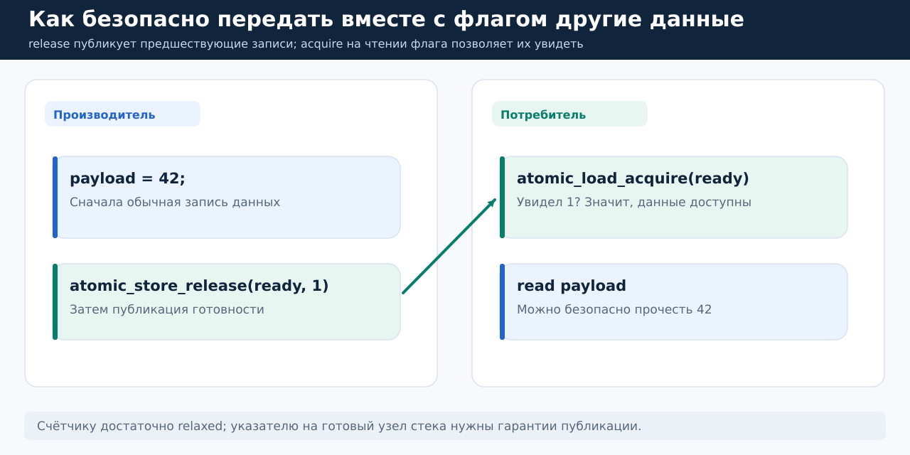

*Рисунок 9.* Сначала производитель заполняет данные, затем выполняет `store` с `release`. Потребитель проверяет флаг с `acquire` и, увидев опубликованное значение, может читать предшествующие записи производителя. Здесь предполагается, что `payload` не меняется одновременно после публикации и нет других несинхронизированных доступов к нему.

```c
/* Схематический вариант: производитель и потребитель, payload общий. */
int payload = 0;
atomic_int ready = ATOMIC_VAR_INIT(0);

/* Поток производителя: */
payload = 42;
atomic_store_explicit(&ready, 1, memory_order_release);

/* Поток потребителя: */
while (!atomic_load_explicit(&ready, memory_order_acquire)) {
    /* Только демонстрация: настоящее ожидание лучше делать через cond/futex. */
}
printf("%d\n", payload); // Здесь можно прочитать 42.
```

Пара `release → acquire` даёт happens-before (отношение порядка между действиями), если чтение `acquire` получило значение, записанное соответствующим `release` (или подходящей release-последовательностью).

Можно запомнить так: `relaxed` — только атомарный счётчик; `release/acquire` — безопасная передача подготовленных данных. По умолчанию атомарные операции C используют более строгий `memory_order_seq_cst`; мы вводим `_explicit`, чтобы осмысленно различать требования. Нюансы всей модели памяти выходят за рамки этого введения.

---

## 3. Новая задача: у производителя иногда нет готовых данных

Счётчик уже умеем исправлять. Теперь один поток-производитель кладёт числа в ячейку, а поток-потребитель забирает их. Ячейка вмещает ровно одно число.

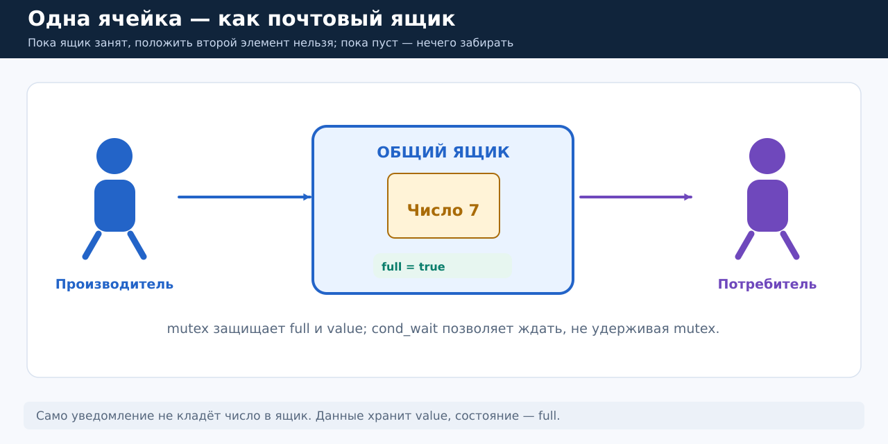

*Рисунок 10.* «Ящик» — обычные поля памяти `value` и `full`. `full=false` означает «ящик пуст»; `full=true` — «в нём лежит число». `mutex` нужен для согласованного доступа к обоим полям. Уведомление не содержит само число, оно лишь помогает разбудить ожидающего.

### Почему нельзя просто бесконечно проверять `full`?

Можно было бы написать:

```c
while (!full) {
    /* Снова и снова читать переменную. */
}
```

Если `full` — обычный неатомарный флаг, изменяемый другим потоком, такой код имеет data race. Даже если сделать `full` атомарным, программа будет постоянно расходовать CPU на проверку — **busy waiting**, **активное ожидание**. Для коротких специальных низкоуровневых сценариев оно иногда допустимо, но при долгом отсутствии данных лучше **усыпить поток**.

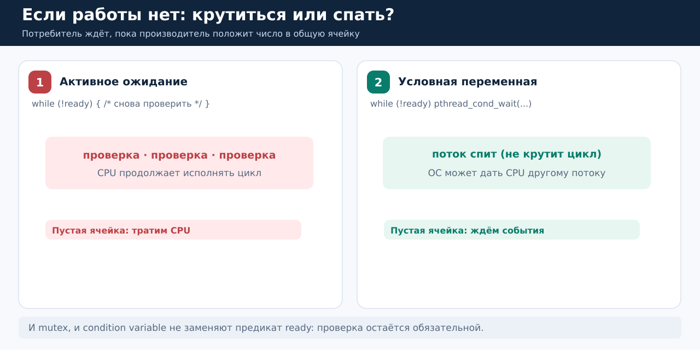

*Рисунок 11.* Слева цикл многократно выполняется, даже когда данных нет. Справа поток блокируется, а CPU может выполнять другую работу. После пробуждения нужно заново проверить, действительно ли появились данные.

### `pthread_cond_t`: условная переменная

**Condition variable (условная переменная)** позволяет потоку заснуть до уведомления, что состояние *могло* измениться. Само состояние — это наши поля `full`, `value`, `closed`. Условная переменная не хранит количество отправленных уведомлений.

Откройте `src/03_condition.c`. Там объявлена структура:

```c
typedef struct {
    pthread_mutex_t mutex;    // Защищает все поля ниже.
    pthread_cond_t not_empty; // Потребитель ждёт данные или закрытие.
    pthread_cond_t not_full;  // Производитель ждёт свободную ячейку.
    int value;                // Полезное число.
    bool full;                // Занято ли место?
    bool closed;              // Новых чисел больше не будет.
    unsigned empty_wakeups;  // Счётчик бесполезных пробуждений.
    int sum;                  // Результат потребителя.
} Slot;
```

Здесь две условные переменные, потому что есть два разных ожидания: потребитель ждёт «ячейка не пуста», а производитель — «ячейка не занята». Но mutex один и тот же, потому что все поля описывают *одно состояние ячейки. В примере объекты созданы статическими инициализаторами `PTHREAD_MUTEX_INITIALIZER` и `PTHREAD_COND_INITIALIZER`. Альтернатива — `pthread_mutex_init` и `pthread_cond_init`; после завершения всех работающих потоков соответствующие ресурсы освобождают через `pthread_mutex_destroy` и `pthread_cond_destroy` (см. конец `run_good()`).

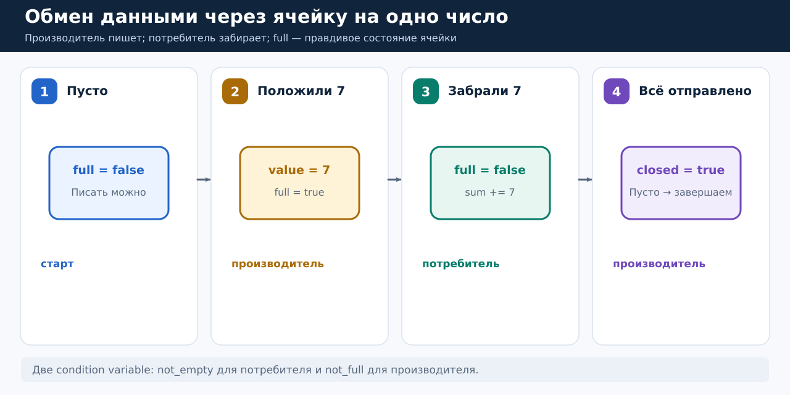

*Рисунок 12.* Сначала ячейка пуста. Производитель кладёт число 7 и ставит `full=true`. Потребитель читает его и делает `full=false`. По окончании передачи производитель выставляет `closed=true`; это отдельный признак, помогающий потребителю не ждать вечно после последнего элемента.

### Что делает `pthread_cond_wait`?

Наивная попытка: «потребитель захватит mutex, увидит пустую ячейку и уснёт, не отпуская mutex». Это тупик: производителю нужен тот же mutex, чтобы положить число, но его удерживает спящий потребитель.

Поэтому `pthread_cond_wait(&cond, &mutex)` делает особую последовательность:

1. Вызывающий поток уже владеет `mutex` и проверил предикат.

2. Функция атомарно относительно протокола уведомления отпускает mutex и начинает ожидание. Между «решил ждать под mutex» и «отпустил mutex и поставил себя в ожидание» не возникает щели для потери корректного уведомления.

3. Другой поток может захватить mutex, изменить состояние и послать уведомление.

4. После пробуждения `pthread_cond_wait` вновь захватывает тот же mutex и лишь затем возвращает управление вызывающему потоку.

5. Поток повторно проверяет предикат, а не предполагает, что данные уже есть.

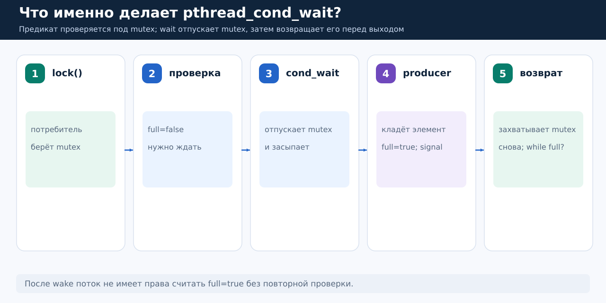

*Рисунок 13.* Слева направо — состояния одного потребителя и производителя. Отдельно заметим: «проснулся» и «снова владею mutex» не одно и то же; перед возвратом `pthread_cond_wait` должен получить mutex. Это причина, почему другие потоки могут успеть изменить данные ещё до проверки проснувшегося потребителя.

Код потребителя из `consumer()` (сокращены счётчик пробуждений и закрывающие скобки цикла):

```c
pthread_mutex_lock(&slot.mutex);

while (!slot.full && !slot.closed) {
    pthread_cond_wait(&slot.not_empty, &slot.mutex);
}

if (!slot.full && slot.closed) {
    pthread_mutex_unlock(&slot.mutex);
    break;  // Производитель закончил и данных больше нет.
}

slot.sum += slot.value;  // Здесь full == true.
slot.full = false;       // Место снова свободно.
pthread_cond_signal(&slot.not_full);
pthread_mutex_unlock(&slot.mutex);
```

Как читать условие `while (!full && !closed)`: «пока ячейка пуста и производитель ещё не завершил работу, мне нечего делать — жду». Если ячейка полна, можно забрать значение. Если пустая и закрыта, можно закончить работу.

Код производителя из `producer()`:

```c
pthread_mutex_lock(&slot.mutex);

while (slot.full) {
    pthread_cond_wait(&slot.not_full, &slot.mutex);
}

slot.value = value; // Сначала кладём данные.
slot.full = true;   // Затем отмечаем, что они появились.
pthread_cond_signal(&slot.not_empty); // Сообщаем потребителю.
pthread_mutex_unlock(&slot.mutex);
```

Защитой от неправильного переписывания данных занимается предикат `full` под mutex; `signal` не заменяет этот флаг. При завершении производитель отдельно выставляет `closed=true` и посылает `pthread_cond_broadcast(&slot.not_empty)`, чтобы ожидающий потребитель мог прекратить работу.

`signal` и `broadcast`: `pthread_cond_signal` будит как минимум одного ожидающего в обычном случае, если они есть; `pthread_cond_broadcast` предназначен для пробуждения всех текущих ожидающих. Оба сами по себе не устанавливают предикат и не дают пробуждённому исключительное право на данные. В нашем сценарии есть один потребитель, но при завершении `broadcast` удобно показывает идею «разбудить всех, кому нужно пересмотреть состояние».

```bash
./build/03_condition good
# queue: sum=55 expected=55, wakeups_with_false_predicate=...
```

Производитель передаёт числа `1, 2, ..., 10`. Потребитель получает их по одному, сумма `55`. Число бесполезных пробуждений может меняться между запусками — это нормально.

### Почему `while`, а не `if`? Spurious wakeups

После `pthread_cond_wait` нельзя автоматически считать `full=true`. Различают:

- **Нерелевантное уведомление:** кто-то явно вызвал `signal`/`broadcast`, но нужное нам состояние не стало истинным. Именно это намеренно делает поток `noise()` из `src/03_condition.c`.

- **Spurious wakeup (ложное пробуждение):** POSIX допускает возврат из `pthread_cond_wait` без соответствующего пользовательского уведомления. Программа должна корректно работать и в этом случае.

- **Потеря условия из-за конкуренции:** даже после реального уведомления другой потребитель мог первым получить mutex и забрать единственный элемент.

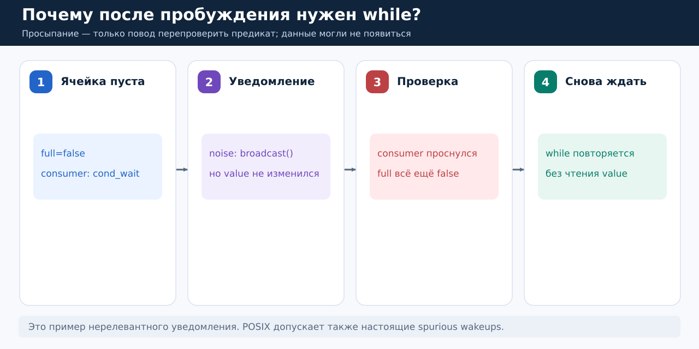

*Рисунок 14.* Потребитель заснул при `full=false`. Третий поток послал `broadcast`, не положив число. Потребитель проснулся, но `full=false` — читать нечего. Поэтому управление должно вернуться к `while`, а не перейти к чтению `value`.

Правильная форма — всегда цикл по предикату:

```c
pthread_mutex_lock(&mutex);
while (!ready) {
    pthread_cond_wait(&cond, &mutex);
}
/* ready действительно true; mutex у нас. */
pthread_mutex_unlock(&mutex);
```

Не стоит «лечить» это заменой `while` на `if` или добавлением `sleep`: пауза не создаёт синхронизацию и не даёт гарантии порядка действий.

### Missing wakeup: как уведомление проходит мимо

Представим задачу:

- поток A ждёт, когда поток B закончит подготовку данных;

- для этого у них есть общий флаг `ready`;

- изначально он равен `false`, а когда данные готовы, B устанавливает `ready=true`;

- пока данные не готовы, A недолжен тратить процессорное время на постоянные проверки, а заснуть;

- когда B закончит, A должен проснуться и продолжить работу.

Сначала разделим три совершенно разные сущности:

| Объект | Что он означает | Чего он **не** делает |
|---|---|---|
| `ready` | Факт: данные готовы (`true`) или ещё нет (`false`). Это состояние в памяти. | Сам по себе не будит потоки. |
| `pthread_cond_t cond` | Звонок: B может вызвать `pthread_cond_signal(&cond)`, чтобы разбудить поток, который уже ждёт на этой условной переменной. | Не хранит историю звонков и не заменяет `ready`. |
| `pthread_mutex_t mutex` | Правило доступа: связывает проверку `ready` и переход к ожиданию с изменением `ready` другим потоком. | Не делает ожидание автоматическим: нужны правильная проверка и `pthread_cond_wait`. |

Бытовая аналогия. Вы ждёте посылку. Признак `ready` — запись на табло «посылка прибыла». `signal` — короткий звонок сотрудника. Если сотрудник позвонил, когда вы ещё не начали слушать звонок, звук уже прошёл. Но запись на табло осталась. Правильная процедура — сначала проверить табло, а если посылки нет, поставить себя в ожидание так, чтобы между проверкой и началом ожидания нельзя было пропустить её поступление.

#### Как возникает ошибка

Попробуем написать ожидание неправильно. Пусть `ready` — атомарный флаг, чтобы не смешивать рассматриваемую ошибку с data race. У A получается такой алгоритм:

```c
/* Неверно: решение ждать основано на проверке вне mutex. */
bool was_ready = atomic_load(&ready);  // (1) сохранили состояние.

/* Здесь планировщик может переключить CPU на поток B. */

if (!was_ready) {                      // (3) Пользуемся старым результатом.
    pthread_mutex_lock(&mutex);
    pthread_cond_wait(&cond, &mutex);  // (4) Ждём, не проверив ready снова.
    pthread_mutex_unlock(&mutex);
}
```

Обратите внимание: `atomic_load` гарантирует корректное атомарное чтение самого флага, но не обещает, что его результат останется актуальным до вызова `wait`.

Рассмотрим  допустимый порядок выполнения. Планировщик вправе приостановить A после первой строки, запустить B, а затем вернуть управление A:

| Шаг | Кто выполняется | Действие | `ready` | Кто ждёт на `cond`? |
|---|---|---|---|---|
| 0 | — | Начальное состояние | `false` | Никто |
| 1 | A | Читает `ready=false`, сохраняет `was_ready=false` | `false` | Никто |
| 2 | A | Прерывается до входа в `pthread_cond_wait` | `false` | Никто |
| 3 | B | Устанавливает `ready=true` — данные готовы | `true` | Никто |
| 4 | B | Вызывает `pthread_cond_signal(&cond)` | `true` | Никто: будить некого |
| 5 | A | Возобновляется; `was_ready` по-прежнему `false` | `true` | Никто |
| 6 | A | Захватывает `mutex`, вызывает `pthread_cond_wait` и засыпает | `true` | A ждёт |
| 7 | — | B больше не вызывает `signal`, так как работу уже закончил | `true` | A может ждать бесконечно |

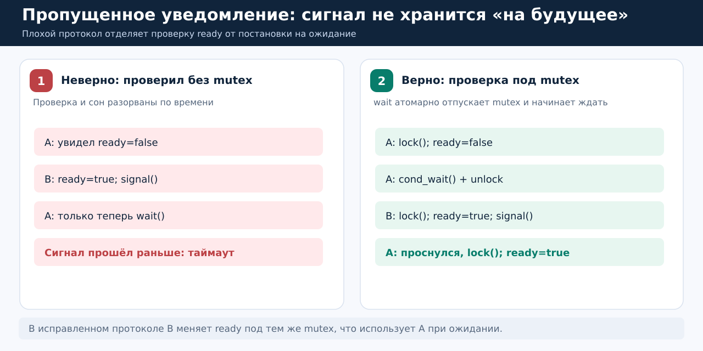

*Рисунок 15.* В ошибочном варианте проверка `ready` и начало ожидания разорваны: B успевает отправить `signal` между ними. A спит, хотя работа уже сделана. Справа показан правильный протокол: проверка `ready` и переход к `cond_wait` выполняются под одним и тем же mutex, который B также использует для изменения `ready`.

Итак, **missing wakeup (lost wakeup, пропущенное уведомление)** — ситуация, когда поток решает ждать по уже устаревшей проверке состояния, а нужное уведомление прошло до того, как поток действительно начал ожидать. Условная переменная не запоминает вызовы `signal` для будущих ожидающих. Если позже не будет других уведомлений или ложного пробуждения, поток останется заблокированным, несмотря на `ready=true`.

Здесь важно различить два утверждения:

- «Сигнал прошёл, когда никто не ждал» — не обязательно ошибка. Если A после этого заново проверит `ready=true`, он просто продолжит работу без ожидания.

- «A пропустил сигнал и заснул, не проверив новое состояние» — ошибка. Именно это произошло.

Почему не помогают простые поправки? Добавить `sleep` перед `signal` — не гарантия: планировщик не обязан выполнять потоки в ожидаемом порядке. Сделать `ready` атомарным — тоже недостаточно: это устраняет data race на флаге, но не делает неразрывной пару «проверка → ожидание». Захватить `mutex` непосредственно перед `pthread_cond_wait` также недостаточно, если проверка `ready` сделана раньше, как в показанном неверном коде.

#### Где эта ошибка находится в коде

Откройте `src/03_condition.c` и найдите функции `bad_waiter()` и `bad_notifier()`.

В `bad_waiter()` поток A сначала выполняет:

```c
bool was_ready = atomic_load_explicit(&ready, memory_order_acquire);
pthread_barrier_wait(&checked);
pthread_barrier_wait(&notified);
```

Здесь `was_ready` — снимок значения на момент чтения. Барьер `checked` даёт B знать, что A уже прочитал `false`. Затем B, в функции `bad_notifier()`, устанавливает `ready=true` и посылает `pthread_cond_signal(&lost_cond)`. Барьер `notified` гарантирует, что A продолжит работу только после этого сигнала. То есть барьеры нужны здесь исключительно для воспроизведения ошибки в заданном порядке, а не как способ её исправления.

Далее A использует старый снимок:

```c
if (!was_ready) {
    pthread_mutex_lock(&lost_mutex);
    /* В исходнике здесь вычисляется абсолютный deadline. */
    pthread_cond_timedwait(&lost_cond, &lost_mutex, &deadline);
    pthread_mutex_unlock(&lost_mutex);
}
```

`pthread_cond_timedwait` отличается от обычного `pthread_cond_wait` тем, что ожидание может завершиться с кодом `ETIMEDOUT` после достижения заданного абсолютного времени. Возврат может произойти позже: потоку ещё нужно снова получить mutex и получить процессорное время. Мы используем его только для того, чтобы учебная программа не зависла навсегда: в исходнике задано время примерно на 100 мс позже текущего. Значение `deadline` — это абсолютное время для `CLOCK_REALTIME`, а не длительность ожидания.

```bash
make build/03_condition
./build/03_condition lost
# Обычный ожидаемый результат:
# missing-wakeup: ready_now=1, wait_result=ETIMEDOUT (notification lost)
```

Прочитайте вывод буквально: `ready_now=1` говорит «данные уже готовы», а `ETIMEDOUT` — «поток так и не получил ожидаемого пробуждения до срока». В этом состоит парадокс ошибки. POSIX допускает спонтанные пробуждения, поэтому демонстрация с таймаутом не может *абсолютно гарантировать* `ETIMEDOUT` во всякой реализации, но барьеры гарантируют порядок «проверка → уведомление → попытка ожидания».

#### Правильное решение на C: один mutex для проверки и изменения состояния

Нужно не запоминать `ready` заранее, а проверять его под mutex и, если оно ложно, переходить в ожидание, передавая тот же mutex в `pthread_cond_wait`. Изменять `ready` поток B должен, также владея этим mutex.

Флаг `ready` теперь обычный `bool`, не `_Atomic`: оба потока читают и записывают его только под защитой mutex, поэтому data race нет.

```c
pthread_mutex_t mutex = PTHREAD_MUTEX_INITIALIZER;
pthread_cond_t cond = PTHREAD_COND_INITIALIZER;
bool ready = false;  // Общее состояние. Доступ только при захваченном mutex.

void *waiter(void *arg) {
    (void)arg;

    pthread_mutex_lock(&mutex);  // A получает право читать ready.

    while (!ready) {             // Условие проверяем под mutex.
        /* Если данных нет, wait:
         * 1) отпустит mutex и начнёт ожидание как одно действие
         *    относительно протокола блокировки/уведомления;
         * 2) после пробуждения снова захватит mutex;
         * 3) только затем вернёт управление сюда.
         * Цикл повторно проверит ready. */
        pthread_cond_wait(&cond, &mutex);
    }

    puts("A: данные готовы, продолжаю работу");
    pthread_mutex_unlock(&mutex);
    return NULL;
}

void *notifier(void *arg) {
    (void)arg;

    pthread_mutex_lock(&mutex);  // B синхронизируется с проверкой A.
    ready = true;                // сначала меняет состояние.
    pthread_cond_signal(&cond); // потом уведомляет ожидающего (если есть).
    pthread_mutex_unlock(&mutex);
    return NULL;
}
```

Принципиально важно не пытаться заменить `pthread_cond_wait(&cond, &mutex)` последовательностью `pthread_mutex_unlock(&mutex); ...; pthread_cond_wait(...)`: последняя функция требует, чтобы вызывающий поток уже владел mutex; отдельное освобождение также снова открыло бы опасный промежуток. В отличие от этого, `pthread_cond_wait` атомарно относительно протокола POSIX condition variable освобождает mutex и блокирует поток.

Главное правило: условная переменная — не очередь уведомлений. Всегда проверяйте реальное условие под mutex; пока оно ложно, вызывайте `pthread_cond_wait` с этим же mutex; меняйте условие под тем же mutex и уведомляйте об изменении. Тогда ранний `signal` не опасен: поток либо уже ждёт и сможет проснуться, либо увидит готовое состояние и не будет ждать.


### То же ожидание в C++17

В C++ используются `std::mutex`, `std::condition_variable` и `std::unique_lock`:

```cpp
std::mutex mutex;
std::condition_variable cv;
bool ready = false;

// В потоке-потребителе:
std::unique_lock<std::mutex> lock(mutex);
cv.wait(lock, [&] { return ready; });
// После возврата ready == true, lock снова владеет mutex.
```

Здесь `cv.wait(lock, predicate)` логически эквивалентно циклу `while (!predicate()) cv.wait(lock)`. Объект `std::unique_lock` нужен именно потому, что `wait` умеет временно освобождать и повторно захватывать mutex. `std::lock_guard` для этой операции не подходит.

В полном `cpp/std_condition.cpp` есть отдельные producer и consumer, число `42`, `std::thread::join` и атомарный счётчик.

```bash
./build/cpp_std_condition
# C++ consumer received 42
# C++ atomic updates=1
```

---

## 4. Futex: зачем для ожидания вообще нужно ядро Linux?

С условной переменной понятно что должен делать поток: ждать, не удерживая mutex. Теперь посмотрим как в Linux может быть устроена низкоуровневая блокировка.

Переключение между пользовательской программой и ядром ОС не бесплатно. Поэтому реализации некоторых примитивов сначала пытаются выполнить быструю операцию с атомарным словом в пользовательском пространстве. Если ожидать действительно необходимо, они обращаются к ядру за помощью в блокировке. Такой низкоуровневый механизм в Linux называется **futex** (**fast userspace mutex**).

В Linux/glibc `pthread_mutex` и `pthread_cond` могут использовать futex внутри, но **futex — не готовый mutex и не готовая condition variable**. Это набор низкоуровневых возможностей.

###  Что означают `FUTEX_WAIT` и `FUTEX_WAKE`

Пусть имеется корректно расположенное **32-битное слово** `_Atomic uint32_t ready`. Значение `0` означает «не готово», `1` — «готово».

- `FUTEX_WAIT(addr, 0)` просит ядро: «поставь меня на ожидание только если по адресу `addr` всё ещё `0`». Проверка значения и постановка в очередь ожидания образуют атомарный compare-and-block относительно операций ожидания/пробуждения futex.

- Если в момент проверки уже `1`, ядро не усыпляет поток и обычно возвращает `-1` с `errno=EAGAIN`.

- `FUTEX_WAKE(addr, n)` будит до `n` ожидающих на соответствующем futex. Само значение памят оно не изменяет.

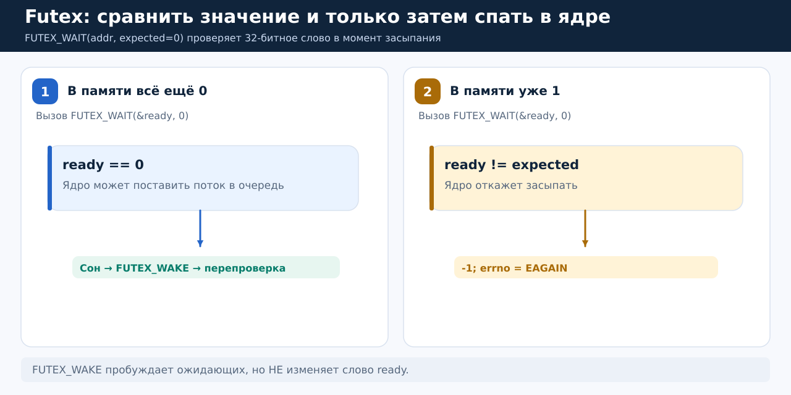

*Рисунок 16.* Слева по адресу пока `0`: ядро может поставить поток ждать до `WAKE` или другого основания возврата. Справа другой поток уже записал `1`: ожидание с `expected=0` не начинается, возвращается `EAGAIN`. Но после любого возврата программа всё равно должна снова проверить `ready`.

Откройте `src/04_futex.c`. В нём есть функции-обёртки вокруг `syscall(SYS_futex, ...)`:

```c
int futex_wait(_Atomic uint32_t *word, uint32_t expected) {
    return (int)syscall(SYS_futex, (uint32_t *)(void *)word,
                        FUTEX_WAIT_PRIVATE, expected, NULL, NULL, 0);
}

int futex_wake(_Atomic uint32_t *word) {
    return (int)syscall(SYS_futex, (uint32_t *)(void *)word,
                        FUTEX_WAKE_PRIVATE, 1, NULL, NULL, 0);
}
```

Вариант `PRIVATE` применяется для потоков одного процесса. Здесь используются Linux/GCC и требования к размеру, выравниванию и представлению 32-битного `_Atomic`-объекта. Это не переносимый на любые ОС пример библиотечного мьютекса.

### Нормальный сценарий и «позднее» ожидание

```bash
./build/04_futex normal
./build/04_futex late
```

В `normal` ждущий поток пока видит `ready=0` и может обратиться к `FUTEX_WAIT`. Главный поток устанавливает `ready=1` с `memory_order_release` и вызывает `FUTEX_WAKE`. Ждущий поток затем читает `ready` с `memory_order_acquire` и продолжает работу. Он может успеть увидеть `ready=1` до системного вызова — тогда `WAKE` разбудит ноль потоков, и это корректно.

В `late` сначала выставляется `ready=1` и выполняется `WAKE`, когда ожидающих ещё нет. Затем вызывается `FUTEX_WAIT(&ready, 0)`. Ядро сравнивает 1 ≠ 0, поэтому не засыпает и возвращает `EAGAIN`.

Заметьте различие с ошибочным примером condition variable: там решение ждать опиралось на *старый локальный снимок* без правильного mutex. Здесь сам `FUTEX_WAIT` ещё раз проверяет текущее значение непосредственно при постановке на ожидание. Это не отменяет необходимости правильно организовать общий предикат и повторять его проверку после wake.

Полезно посмотреть обращения к ядру:

```bash
strace -f -e trace=futex ./build/04_futex normal
```

`-f` включает дочерние потоки в трассировку, `-e trace=futex` оставляет вызовы futex. Отсутствие конкретного вызова в другой программе не означает отсутствия синхронизации: быстрый путь mutex может не обращаться к ядру. Для обычного прикладного кода предпочитайте `pthread_mutex_t` и `pthread_cond_t`, а futex изучайте для понимания реализации.

---

## 5. Неблокирующие алгоритмы: стек с атомарной вершиной

До сих пор использовали mutex, чтобы на время работы с общей структурой не пускать в неё другой поток. Можно попробовать иначе: каждый поток оптимистично готовит изменение, а затем с помощью CAS пытается разом заменить одну общую ссылку. Если проиграл, пересчитывает своё изменение и пробует снова.

Этот подход часто встречается в **lock-free** алгоритмах. Он не гарантирует более высокую скорость: частые проигрыши CAS тоже расходуют процессорное время. Зато операции не зависят от владения пользовательским mutex.

### Стек на обычном односвязном списке

**Стек** — структура LIFO: что положили последним, то извлекаем первым. Узел хранит значение и указатель на следующий узел:

```c
typedef struct Node {
    int value;
    struct Node *next;
} Node;

typedef struct {
    _Atomic(Node *) head; // Общий адрес верхнего элемента.
} Stack;
```

Если стек хранит `30 → 20 → 10`, то `head` указывает на узел `30`. Операция `push(40)` должна сделать `40 → 30 → 20 → 10`. `pop()` должен удалить текущую вершину и вернуть извлечённый узел.

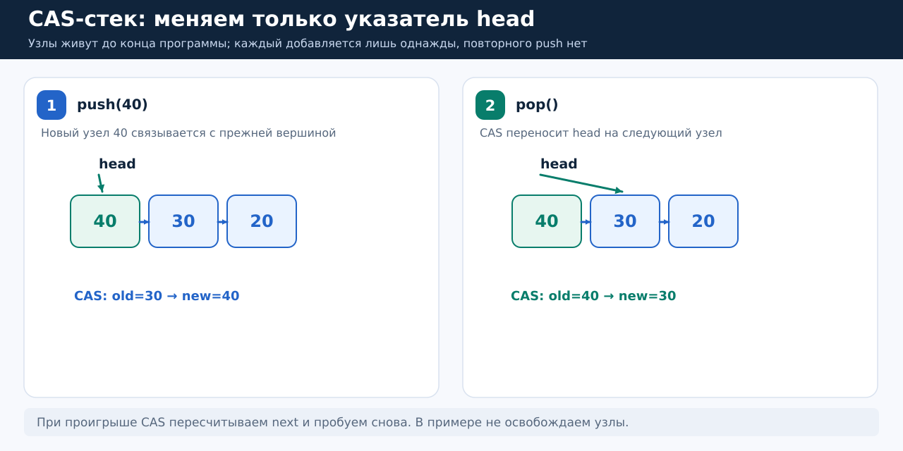

*Рисунок 17.* Слева успешный `push(40)`: новый узел 40 получает ссылку на прежнюю вершину 30, а CAS меняет `head` на 40. Справа успешный `pop()`: CAS сдвигает `head` с 40 на следующий узел 30. В каждом случае общим изменяемым атомарным объектом является один указатель `head`.

### Почему `head = new_node` неверно?

Предположим, поток A запомнил старый `head=30`, а поток B тем временем успел положить узел `50`. Если A просто присвоит `head=40`, узел `50` потеряется из цепочки.

Вместо этого A использует CAS: «Поставь `head=40`, только если текущий `head` всё ещё `30`». Если B уже поставил `50`, CAS откажет, A присоединит 40 перед 50 и повторит попытку. Это та же логика, которую мы уже разобрали для атомарного счётчика.

### `stack_push`: пройти код по строкам

Откройте `src/05_stack.c`:

```c
void stack_push(Stack *stack, Node *node) {
    Node *seen = atomic_load_explicit(&stack->head, memory_order_acquire);
    do {
        node->next = seen;
    } while (!atomic_compare_exchange_weak_explicit(
        &stack->head, &seen, node,
        memory_order_acq_rel, memory_order_acquire));
}
```

1. `seen` — локальный снимок вершины, например адрес 30. Он может устареть сразу после чтения.

2. `node->next = seen` связывает новый узел с предполагаемой вершиной. Мы пока не опубликовали новый узел другим потокам, поэтому менять его поле `next` безопасно.

3. CAS сравнивает общий `head` с `seen`. Успех: новый узел становится вершиной. Неуспех: `seen` обновится действительной вершиной, цикл заново выставит `node->next` и повторит попытку.

4. `acq_rel` при успехе нужен для публикации подготовленного узла и получения опубликованной ранее цепочки; `acquire` на неуспехе помогает безопасно принять новую вершину для следующей попытки.

Это только учебный вариант: он опирается на специальные ограничения времени жизни узлов, указанные ниже.

### `stack_pop`: почему память нельзя поспешно освобождать

```c
Node *stack_pop(Stack *stack) {
    Node *seen = atomic_load_explicit(&stack->head, memory_order_acquire);
    while (seen != NULL) {
        Node *next = seen->next;
        if (atomic_compare_exchange_weak_explicit(
                &stack->head, &seen, next,
                memory_order_acquire, memory_order_acquire)) {
            return seen;
        }
    }
    return NULL;
}
```

Здесь `seen->next` — не атомарное чтение поля узла, который когда-то был вершиной. Если бы другой поток мог в тот же момент освободить его (`free(seen)`), обращение стало бы опасным (use-after-free). Если бы узел могли заново вставить и изменить `next`, тоже пришлось бы заново доказывать безопасность.

В нашем проекте приняты строгие учебные ограничения:

1. Все узлы выделяются до запуска потоков и живут до их завершения.

2. Каждый узел вставляется только один раз; после успешного `pop` его никогда не вставляют повторно.

3. Сначала четыре потока добавляют элементы, и `main` ждёт их через `pthread_join`. Затем четыре других потока удаляют элементы. Поэтому если `pop` увидел `NULL`, известно, что новых вставок уже не будет.

4. Память массива освобождается после завершения всех потоков.

Именно благодаря этим ограничениям чтение `seen->next` в учебном алгоритме допустимо.

```bash
./build/05_stack
# popped=20000/20000 sum=200010000/200010000 lock_free=1
```

Проверяются количество извлечений и сумма чисел `1..20000`.

### Lock-free и wait-free — не синонимы

**Lock-free:** если потоки продолжают выполнять шаги алгоритма, система в целом гарантирует прогресс: из-за конкуренции один поток может проигрывать CAS, но успешное изменение другого показывает, что кто-то продвинулся. Это гарантия для системы, а не конечного времени завершения каждого потока.

**Wait-free:** у каждого потока есть ограничение числа собственных шагов, необходимых для завершения операции, независимо от действий остальных. Наш стек не wait-free: отдельный поток может много раз проиграть CAS.

Atomic не обязательно lock-free: стандарт языка допускает реализацию атомарной операции с внутренней блокировкой. Поэтому пример проверяет `atomic_is_lock_free(&stack.head)` и требует подходящую платформу.

### Проблема ABA: CAS сравнил адрес, но не заметил историю

Есть ещё один тонкий случай. Поток T1 запомнил вершину `A` и `A->next=B`. Пока он отвлёкся, T2 снял с вершины `A`, потом `B`, а затем вернул тот же узел A обратно. Текущая вершина опять `A`, но после неё уже `C`.

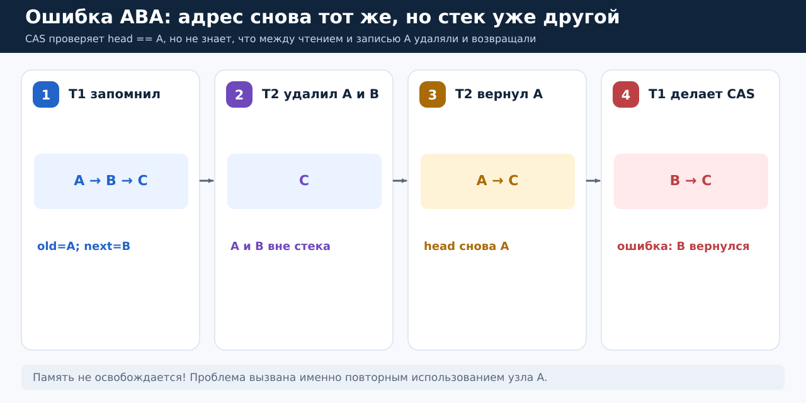

*Рисунок 18.* (1) T1 запомнил `head=A`, `stale_next=B` из цепочки `A → B → C`. (2) T2 удалил A и B, остался C. (3) T2 вернул тот же A: стало `A → C`. (4) T1 запоздало делает `CAS(head, A, B)`. CAS видит совпадение `head==A` и успешно выставляет `B` как вершину. Но B уже был удалён! Получилась логическая ошибка.

```bash
./build/06_aba
# ABA: stale CAS succeeded=1; observed head=B (should be A)
```

В `src/06_aba.c` барьеры задают точный порядок действий двух потоков. Память не освобождается: значит, ABA — не то же самое, что use-after-free. Она может возникнуть просто из-за повторного использования живого узла. Мы специально разделяем эти проблемы.

Общие промышленные решения требуют дополнительной инженерии: например, атомарную пару «адрес + версия», контроль повторного использования узлов и методы безопасного освобождения памяти (*hazard pointers*, *epoch-based reclamation*). При этом защита времени жизни сама по себе не устраняет произвольное повторное добавление узла и логическую ABA.

В данном проекте ABA предотвращена в `05_stack.c` именно запретом повторного `push` одного узла, а не тем, что CAS как-то умеет её распознавать.

---

## 6. Как выбрать механизм: карта после всех примеров

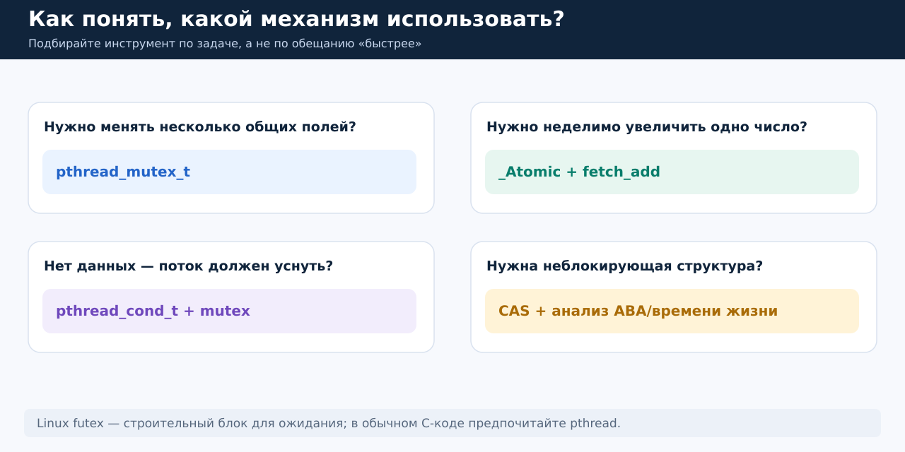

*Рисунок 19.* Выбор определяется задачей. Для нескольких связанных полей проще mutex; для одного числового обновления удобен атомарный `fetch_add`; для ожидания появления работы — mutex + condition variable; для неблокирующих структур используют CAS, но должны доказать корректность владения памятью.

| Механизм | Хорошая первая задача | Что помнить |
|---|---|---|
| `pthread_mutex_t` | Согласованно изменить несколько общих полей | Все обращения защищены одним mutex; соблюдать unlock |
| `_Atomic`, `atomic_fetch_add` | Счётчик обращений, статистика | `load` + `store` не равны атомарному `+1` |
| CAS | Обновить значение только при совпадении со снимком | Неуспех требует нового снимка и пересчёта; возможна ABA |
| `pthread_cond_t` | Подождать появления элемента в очереди | while по предикату, один mutex для проверки и изменения состояния |
| `futex` | Понять, как Linux может организовать ожидание | Низкоуровневая платформа-специфичная деталь, не готовый объект mutex |
| Lock-free стек | Учебная структура с атомарной вершиной | Ограничения на память, повторное использование, порядок памяти |

## 7. Отладка

`make test` сознательно не запускает заведомо UB-режим `unsafe`, но проверяет остальные учебные сценарии, включая специально воспроизводимые логические ошибки.

**ThreadSanitizer (TSan)** — инструмент для поиска data race при выполнении программы. Он не доказывает отсутствие всех гонок и может не работать в некоторых виртуализированных средах. Однажды полученное правильное значение счётчика также ничего не доказывает.

```bash
make tsan
./build/01_counter_tsan unsafe  # ожидаем диагностическое сообщение data race
./build/01_counter_tsan mutex   # для counter предупреждения быть не должно
```

## Источники

- [POSIX `pthread_create`](https://man7.org/linux/man-pages/man3/pthread_create.3.html) и [`pthread_join`](https://man7.org/linux/man-pages/man3/pthread_join.3.html): создание и завершение потоков.

- [POSIX `pthread_mutex_lock`](https://man7.org/linux/man-pages/man3/pthread_mutex_lock.3p.html): правила владения mutex.

- [POSIX `pthread_cond_wait`](https://man7.org/linux/man-pages/man3/pthread_cond_wait.3p.html): отпускание/повторный захват mutex, предикаты, пробуждения.

- [Linux `futex(2)`](https://man7.org/linux/man-pages/man2/futex.2.html) и [`FUTEX_WAIT`](https://man7.org/linux/man-pages/man2/FUTEX_WAIT.2const.html): системный вызов и compare-and-block.

- C11 `<stdatomic.h>` и главы о memory model в выбранном учебнике C; для C++ — [`std::atomic`](https://en.cppreference.com/w/cpp/atomic/atomic.html) и [`std::condition_variable`](https://en.cppreference.com/w/cpp/thread/condition_variable.html).
